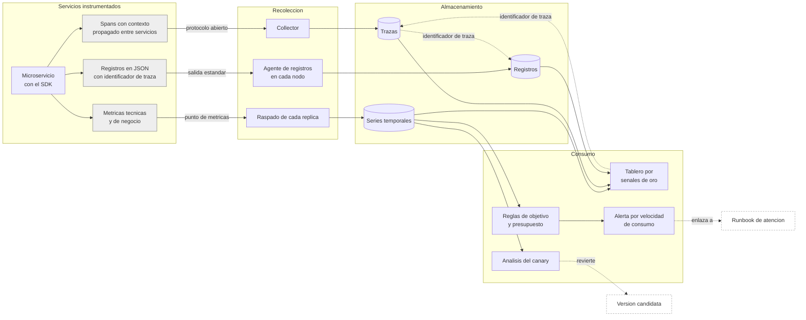

# Practica 10

Observabilidad y operacion, del sintoma a la causa.

El sistema entregado hasta ahora se construye, despliega, protege y recupera solo, pero no sabia explicarse a si mismo. Ante un reporte de lentitud no habia forma de decir que servicio la provocaba, la promocion del canary dependia de pruebas sinteticas escritas por quien las iba a aprobar, y nadie podia afirmar si la plataforma cumple lo que promete a sus usuarios. Ahora cada peticion deja una traza que cruza los servicios, cada servicio expone metricas tecnicas y de negocio, cada linea de registro lleva el identificador de su traza, y el canary promueve o revierte segun el comportamiento real de la version candidata bajo trafico.

## Tabla de enlaces

| Item | Enlace o dato |
|---|---|
| Repositorio de codigo | https://github.com/jaguzaro/Practicas-SA-B-202201395 |
| Repositorio GitOps | https://github.com/jaguzaro/Practicas-SA-B-202201395-gitops |
| Servicios instrumentados | auth-api, authz-service y transactions-service, en el namespace sa-p8 |
| AnalysisTemplate por metricas | transactions-service-canary, definido en P8/charts/transactions-service/templates/analysistemplate.yaml y replicado en los charts de auth-api y authz-service |
| Consultas del analisis | tasa-de-error, proporcion de respuestas de familia 5xx sobre el total de peticiones de la version candidata, y latencia-p95, percentil 95 de http_server_duration_seconds_bucket, ambas filtradas por version_pod. Texto completo de las dos consultas en P10/evidencias/canary-por-metricas.txt |
| SLO declarados | Disponibilidad del 99.5 por ciento y latencia del registro de lotes bajo medio segundo en el 99 por ciento de las peticiones, ambos sobre una ventana de treinta dias |
| Reglas de alerta | observabilidad/alertas.yaml en el repositorio GitOps, con copia en P10/slo/alertas.yaml |
| Tablero | P10/tableros/operacion.json |
| Reversion por metricas | AnalysisRun transactions-service-595bd5d469-11-2 fallido sobre el Rollout transactions-service del namespace sa-p8, detalle en P10/evidencias/reversion-por-metricas.txt |
| Recorrido sintoma a causa | P10/evidencias/sintoma-a-causa.txt, cinco segundos de la alerta a la causa |
| Video demostrativo | https://drive.google.com/file/d/1wc79yikD4XOXPOiem3wEF4B0LMKO6Klu/view |

## Diagrama del flujo de telemetria

Las tres senales salen del mismo proceso y vuelven a encontrarse por el identificador de traza, que es lo que permite recorrer el camino en los dos sentidos. Desde el tablero se salta a la traza que explica una latencia anomala, y desde la traza a las lineas de registro que esa misma peticion escribio. Los dos consumidores automaticos son la regla de presupuesto, que decide cuando despertar a alguien, y el analisis del canary, que decide si una version se promueve.

## Instrumentacion

Los tres servicios de TypeScript comparten un modulo de telemetria que el proceso carga antes que cualquier otra cosa, de modo que los proveedores de trazas y metricas existen antes de que el primer modulo los pida.

El middleware de entrada extrae el contexto de la peticion segun el estandar de propagacion, abre un span de servidor y lo deja activo durante toda la peticion. Los clientes que llaman a otros servicios inyectan ese contexto en sus cabeceras, de modo que una peticion que entra por el gateway y pasa por transacciones, autorizacion y auditoria queda bajo un unico identificador de traza. El gateway reenvia las cabeceras sin tocarlas, asi que la cadena no se rompe al entrar.

La instrumentacion es explicita y no automatica. Con modulos de tipo ECMAScript, el parcheo automatico de las bibliotecas de red no es fiable, y se prefirio escribir el middleware a depender de un mecanismo que falla en silencio. El costo es un archivo mas por servicio y la ganancia es control sobre que se mide y con que etiquetas.

## Metricas

Cada servicio expone un punto de metricas propio que Prometheus raspa replica por replica mediante un PodMonitor. Raspar la replica y no el servicio es lo que conserva la etiqueta del conjunto de replicas al que pertenece cada pod, y sin esa etiqueta el analisis del canary no podria distinguir la version candidata de la estable.

Las tecnicas son la duracion de cada peticion como histograma y el conteo de peticiones, etiquetadas por servicio, metodo, ruta, codigo y familia de respuesta. La ruta se normaliza antes de etiquetar, de modo que consultar mil lotes distintos no genera mil series.

Las de negocio responden preguntas que entiende alguien que no es ingeniero. Cuantos lotes se registran por minuto, cuantas transacciones se rechazan y por que motivo, cuanto monto se procesa, cuantas sesiones se inician y cuantas fallan, cuantos usuarios se dan de alta, y cuantas decisiones de autorizacion se permiten o se deniegan por ruta.

## Registros

Cada linea es un objeto JSON con marca de tiempo, nivel, servicio, mensaje, identificador de traza, identificador de span y los campos propios del evento. El agente que corre en cada nodo los recoge de la salida estandar, interpreta el JSON, promueve el nivel a etiqueta y conserva el identificador de traza como metadato estructurado, que es lo que permite filtrar por traza sin convertir cada identificador en una serie nueva.

Desde una traza se llega a sus registros porque la fuente de trazas enlaza con la de registros filtrando por identificador, y desde un registro se llega a su traza porque el campo del identificador esta declarado como enlace derivado.

## Canary gobernado por metricas

El analisis del canary dejo de ejecutar un trabajo de pruebas sinteticas y ahora consulta Prometheus. Cada paso de promocion espera a que la version candidata acumule trafico real y despues mide dos cosas sobre ella misma, la proporcion de respuestas de servidor y el percentil noventa y cinco de latencia.

La consulta filtra por el identificador del conjunto de replicas de la version candidata, que Argo Rollouts inyecta como argumento al analisis, de modo que lo que se mide es el comportamiento de la version nueva bajo el trafico que le corresponde y no el promedio de todo el servicio. Un umbral de dos por ciento de error y medio segundo de percentil noventa y cinco detienen la promocion, y como el limite de fallos del analisis es cero, una sola medicion fuera de rango aborta el despliegue.

Para que esa medicion exista hace falta que la version candidata reciba peticiones. El Rollout declara un servicio estable y un servicio canario y no hay enrutador de trafico que reparta por peso, de modo que Rollouts mantiene cada servicio apuntando al conjunto de replicas que le corresponde y el gateway, que ademas reutiliza conexiones ya abiertas hacia los pods estables, no alcanza al pod nuevo. El generador de carga que se usa durante el ejercicio llama a los dos servicios por nombre para reproducir lo que haria el reparto por peso. Esta es la limitacion mas seria de la configuracion actual, porque el peso declarado en los pasos del canary describe una intencion y no el trafico que realmente se reparte, y resolverla requiere un enrutador que entienda de pesos.

## Objetivos de nivel de servicio

El primer objetivo es de disponibilidad. El indicador es la proporcion de peticiones del namespace de produccion que no terminan en un codigo de familia cinco, y el objetivo es el 99.5 por ciento sobre treinta dias. El numero sale de lo que la plataforma puede sostener con la arquitectura que tiene, dos replicas por servicio sobre tres nodos sin replicacion de base de datos, y de que medio por ciento de peticiones fallidas al mes deja margen para un despliegue que salga mal y se revierta sin incumplir el compromiso. Prometer tres nueves con esta arquitectura seria prometer algo que no se puede cumplir.

El segundo es de latencia. El indicador es la proporcion de peticiones al servicio de transacciones atendidas en medio segundo o menos, y el objetivo es el 99 por ciento sobre treinta dias. El umbral de medio segundo es el limite a partir del cual registrar un lote deja de sentirse inmediato para quien lo esta usando, y se eligio desde la experiencia del usuario y no desde lo que el sistema ya cumple. El uno por ciento restante admite que la cola de un lote grande o un arranque en frio ocasionalmente pasen de ese limite.

Ambos se calculan con reglas de registro que Prometheus evalua cada treinta segundos, y de ellas sale el presupuesto de error consumido, que es la fraccion del margen mensual ya gastada.

## Alertas

No hay alertas por umbral instantaneo. Las tres existentes miran la velocidad a la que se consume el presupuesto de error, que es lo que distingue un pico irrelevante de una degradacion que va a incumplir el compromiso.

La alerta critica de disponibilidad exige que el ritmo de la ultima hora sea catorce veces superior al sostenible y que la ventana de seis horas lo confirme, lo que equivale a agotar el presupuesto mensual en dos dias. La de aviso usa un ritmo menor sostenido durante mas tiempo y ademas exige que mas de la mitad del presupuesto este gastado. La de latencia replica el criterio critico sobre el otro objetivo.

Pedir las dos ventanas a la vez es lo que evita el ruido, porque un pico de un minuto eleva la ventana corta pero no la larga. Cada alerta enlaza a su runbook en P10/runbooks, y ese runbook dice que mirar, en que orden y que accion tomar.

## Tablero

El tablero esta organizado por las cuatro senales de oro y cada panel responde una pregunta concreta de operacion, no exhibe una metrica disponible. La primera fila muestra el cumplimiento de los dos objetivos y la velocidad de consumo, que es lo que se mira primero ante una alerta. Despues latencia, trafico, errores y saturacion, cada una con un panel que ubica el problema y otro que lo desagrega lo suficiente para dar el siguiente paso. El panel de actividad de negocio existe para que alguien ajeno a la ingenieria pueda mirar la misma pantalla y entender si el sistema esta haciendo su trabajo.

## Fallo inducido y recorrido del sintoma a la causa

El fallo inducido vive en el listado de lotes del servicio de transacciones. Donde habia una consulta unica que devolvia todos los lotes, el commit introduce una consulta adicional por cada lote del resultado y lo presenta como un enriquecimiento del listado con el detalle de cada lote. Sobre los 2265 lotes almacenados son 2266 lecturas en lugar de una. El codigo compila, las pruebas unitarias del servicio pasan, la ruta responde con codigo 200 y el contenido es correcto, asi que una prueba sintetica de codigos de respuesta lo aprueba sin objetar nada. Lo unico que cambia es el tiempo, y por eso es el tipo de fallo que solo una metrica medida sobre la version candidata bajo trafico puede detener.

El recorrido parte de la alerta de presupuesto de latencia y no de saber que se habia desplegado. La regla de registro del objetivo da el sintoma, el percentil 95 desagregado por ruta ubica el servicio y la ruta, el consumo de CPU descarta la falta de recursos, el almacen de registros entrega una peticion concreta de 5652 milisegundos con su identificador de traza, y la traza muestra que el tiempo se consume dentro del span del propio servicio y no en la llamada a autorizacion, que respondio en un milisegundo. El recorrido completo tomo cinco segundos y quedo registrado con marcas de tiempo en P10/evidencias/sintoma-a-causa.txt. El script que lo reproduce es P10/pruebas/sintoma-a-causa.sh.

## Video

https://drive.google.com/file/d/1wc79yikD4XOXPOiem3wEF4B0LMKO6Klu/view

0:00 Presentacion de la practica
0:30 Diagrama del flujo de telemetria, instrumentacion de los servicios, metricas y alertas
1:45 Tablero de operacion, cumplimiento de los dos objetivos y las cuatro senales de oro
3:00 AnalysisTemplate, las dos consultas a Prometheus y el filtro por version candidata
4:30 Rollout abortado por la latencia con la tasa de error en cero
5:15 Evidencias de la entrega y recorrido del sintoma a la causa
6:30 Linea de tiempo de la reversion automatica y cierre en el tablero y ArgoCD

## Preguntas teoricas

### Por que tres senales y no solo una

Porque responden preguntas distintas y ninguna reemplaza a las otras. Las metricas dicen que algo esta mal y desde cuando, son baratas de guardar y se pueden agregar, pero no explican ninguna peticion concreta. Las trazas dicen donde se fue el tiempo dentro de una peticion y que servicio la rompio, pero guardarlas todas es caro y mirarlas sin saber cual buscar es inutil. Los registros dicen por que, con el detalle que el programador decidio dejar, pero sin un identificador que los agrupe obligan a revisar servicio por servicio. El valor no esta en tener las tres sino en que compartan el identificador de traza, porque es lo que convierte tres herramientas separadas en un camino.

### Que cambia cuando el canary se gobierna con metricas en lugar de pruebas sinteticas

Cambia quien decide y con que evidencia. Una prueba sintetica comprueba lo que su autor penso en comprobar, se ejecuta sobre un trafico que el mismo genera y pasa aunque la version nueva sea mas lenta para los usuarios reales. Una consulta a Prometheus mide lo que la version candidata esta haciendo con el trafico que de verdad recibe, incluidas las rutas y los casos que nadie penso en probar. El riesgo que aparece es distinto, porque si la version candidata recibe poco trafico la medicion es ruidosa, y por eso el analisis espera antes de la primera medicion y acota el divisor para que una muestra vacia no se interprete como cero errores.

### Por que alertar por consumo de presupuesto y no por umbral

Porque un umbral instantaneo no distingue entre lo que importa y lo que no. Una tasa de error del cinco por ciento durante treinta segundos a las tres de la madrugada con tres peticiones en vuelo no justifica despertar a nadie, y el mismo cinco por ciento sostenido durante seis horas con trafico real si. El presupuesto de error convierte la pregunta tecnica en una pregunta de compromiso, cuanto margen queda antes de incumplir lo prometido, y la velocidad de consumo responde en cuanto tiempo se va a agotar. Eso da una regla simple para decidir si la alerta amerita intervencion inmediata, puede esperar al dia siguiente, o no deberia existir.

### Que no se puede responder con esta instrumentacion

Varias cosas, y conviene reconocerlas. El muestreo de trazas esta al cien por cien, lo que es viable con el trafico de esta plataforma pero no escalaria, y al introducir muestreo se perderia precisamente la traza del caso raro que se quiere investigar. Las metricas de negocio cuentan eventos pero no siguen a un usuario concreto a lo largo del tiempo, de modo que no responden si un mismo cliente sufre siempre la lentitud. El servicio de auditoria y el gateway no estan instrumentados, asi que una traza que entra por el gateway empieza en el primer servicio de Node y no muestra el tiempo que el gateway consumio en enrutar. Y nada de esto mide lo que ocurre antes de llegar al cluster, de modo que una lentitud de red del lado del usuario seria invisible.

### Por que la ruta se normaliza antes de etiquetar

Porque una etiqueta con muchos valores distintos multiplica las series temporales y termina costando mas memoria que el valor que aporta. Si cada peticion a un lote distinto generara su propia serie, consultar mil lotes crearia mil series por cada combinacion de metodo y codigo, y Prometheus guardaria en memoria una estructura que nadie va a consultar. Normalizar la ruta a su forma con parametro conserva la pregunta util, que operacion es lenta, y descarta la que no lo es, que identificador concreto se consulto. Esa pregunta la responde la traza, que es donde si tiene sentido guardar el detalle de una peticion individual.

### Que alerta falta en este sistema

Falta una sobre la saturacion de las dependencias compartidas. Los dos objetivos declarados miran lo que el usuario experimenta, que es lo correcto, pero ambos se degradan tarde cuando el problema es la base de datos acercandose a su limite de conexiones o el broker acumulando mensajes sin consumir. Una alerta sobre esas dos condiciones avisaria antes de que el usuario lo note, y por eso seria de aviso y no critica, con una accion clara en su runbook. No se incluyo porque el enunciado pide alertas por consumo de presupuesto y esta seria por umbral, pero la distincion tiene sentido, una alerta de sintoma se define por presupuesto y una de causa anticipada por umbral.
