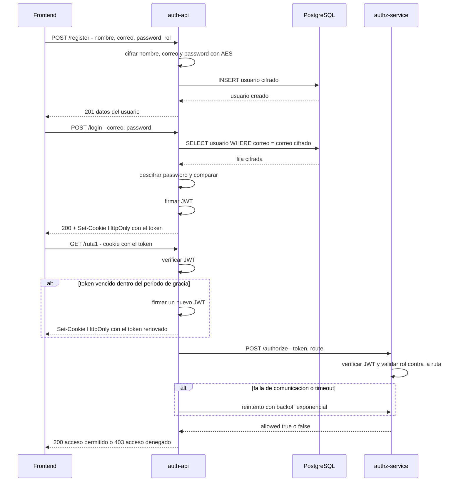

# Practica 2 — Autenticacion y Autorizacion

## Diagrama de secuencia



## Tecnologias utilizadas

### Por que este stack

El backend se armo con **Node.js, TypeScript y Express**. La ventaja es que todo el proyecto queda en un solo lenguaje, ya que el frontend tambien es TypeScript, y el tipado estatico ayuda a detectar errores antes de correr el codigo. La desventaja es que Express no impone ninguna estructura por si solo, a diferencia de un framework como NestJS, entonces la separacion en capas hubo que armarla a mano siguiendo SOLID.

La base de datos es **PostgreSQL**. La ventaja es que es relacional, como pide el enunciado, y soporta bien restricciones como `UNIQUE` y `CHECK` que se usan en la tabla de usuarios. La desventaja es que para un proyecto de este tamano es mas motor del que hace falta, algo como SQLite hubiera alcanzado igual, pero PostgreSQL se eligio pensando en que sea mas facil de escalar despues.

El frontend se armo con **React, Vite y Chakra UI**. La ventaja de Vite es que arranca y recarga cambios muy rapido comparado con otras herramientas, y Chakra UI da componentes ya armados, como formularios y alertas, sin tener que escribir CSS desde cero. La desventaja es que Chakra UI agrega peso extra al proyecto final comparado con CSS puro, y React tiene mas curva de aprendizaje que usar HTML y JavaScript plano para algo tan simple como estos formularios.

### JWT

Es un token que el backend firma con una clave secreta, y adentro lleva el id del usuario junto con su rol. Como esta firmado, si alguien lo altera el backend se da cuenta al verificarlo, asi que no hace falta consultar la base de datos en cada peticion para saber quien es el usuario. El tiempo que dura antes de vencer se cambia con la variable de entorno `JWT_EXPIRATION`.

### Cookies HTTP-only

El JWT no viaja en el cuerpo de la respuesta ni se guarda en `localStorage` o `sessionStorage`. Se guarda en una cookie marcada como `HttpOnly`, que JavaScript no puede leer bajo ninguna circunstancia. De esta forma, aunque exista algun error de seguridad en el frontend, por ejemplo XSS, el token no se puede robar leyendo `document.cookie`. El navegador la manda sola en cada peticion porque el frontend usa `credentials: "include"` en el `fetch`.

Ademas, cuando el JWT vence, el sistema no obliga al usuario a iniciar sesion de nuevo al instante. El backend revisa cuanto tiempo paso desde que vencio, y si todavia esta dentro del tiempo definido en `JWT_GRACE_PERIOD`, genera un token nuevo sin que el usuario note nada. Si ya paso ese tiempo, ahi si toca iniciar sesion otra vez.

### AES

Con este algoritmo, la misma clave sirve para cifrar y para descifrar. Se usa para que el nombre, el correo y la contrasena no queden guardados en texto plano en la base de datos. El correo se cifra de una forma que siempre da el mismo resultado para el mismo texto de entrada, calculando el IV con HMAC en vez de usar uno al azar, y esto se necesita para poder buscarlo en la base con un `WHERE`. El nombre y la contrasena no necesitan buscarse de esa forma, entonces se cifran con un IV distinto cada vez, que es mas seguro.

## Principios SOLID aplicados

### SRP — Responsabilidad Unica

Cada archivo tiene que encargarse de una sola cosa, para que si algo cambia solo haga falta tocar un lugar y no todo el sistema. En `auth-api`, el flujo de usuarios esta dividido en tres partes:

```typescript
// user.controller.ts — solo maneja HTTP: lee el request y arma la respuesta
router.post("/login", async (req, res, next) => {
  const { correo, password } = req.body ?? {};
  const user = await userService.login({ correo, password });
  const token = tokenService.sign({ sub: String(user.id), role: user.rol });
  setAuthCookie(res, token);
  res.status(200).json(user);
});
```

```typescript
// user.service.ts — solo tiene la regla de negocio, no sabe nada de Express ni de SQL
async login(input: LoginInput): Promise<PublicUser> {
  const correoCifrado = this.lookupCipher.encrypt(input.correo);
  const user = await this.repository.findByEncryptedEmail(correoCifrado);
  ...
}
```

```typescript
// postgres-user.repository.ts — solo guarda y busca datos, no conoce reglas de negocio
async findByEncryptedEmail(correoCifrado: string): Promise<UserRecord | null> {
  const result = await this.pool.query<UserRow>(
    "SELECT id, nombre, correo, password, rol FROM usuarios WHERE correo = $1",
    [correoCifrado],
  );
  ...
}
```

Si algun dia cambia una regla del login, solo se modifica `user.service.ts`. Si cambia el motor de base de datos, solo se modifica el repositorio. Las rutas nunca se enteran de esos cambios.

### OCP — Abierto y Cerrado

La idea de este principio es agregar funcionalidad nueva sin modificar el codigo que ya funciona y ya fue probado. En `authz-service`, que rol puede entrar a que ruta esta guardado en una tabla, no en una cadena de `if`:

```typescript
// role-route-policy.ts
const ALLOWED_ROLES_BY_ROUTE: Record<ProtectedRoute, Role[]> = {
  ruta1: ["admin"],
  ruta2: ["admin", "cliente"],
};

export class RoleRoutePolicy implements RoutePolicy {
  isAllowed(role: Role, route: ProtectedRoute): boolean {
    return ALLOWED_ROLES_BY_ROUTE[route].includes(role);
  }
}
```

Agregar una tercera ruta protegida solo pide una entrada nueva en ese objeto. El metodo `isAllowed` no se toca, y como ya esta probado, no hay riesgo de romper algo que ya funcionaba.

### LSP — Sustitucion de Liskov

Si dos clases cumplen la misma interfaz, tendria que poderse usar una en lugar de la otra sin que nada se rompa, y en eso consiste este principio. Aca hay una interfaz `Cipher` que define que tiene que saber hacer un cifrador:

```typescript
// cipher.ts
export interface Cipher {
  encrypt(plainText: string): string;
  decrypt(cipherText: string): string;
}
```

Dos clases cumplen esa interfaz por completo: `AesRandomCipher`, que se usa para nombre y password, y `AesDeterministicCipher`, que se usa para correo. `UserService` solo conoce la interfaz `Cipher`, entonces no le importa cual de las dos le llega, funciona igual con cualquiera:

```typescript
// user.service.ts
constructor(
  private readonly repository: UserRepository,
  private readonly secureCipher: Cipher,
  private readonly lookupCipher: Cipher,
) {}
```

### ISP — Segregacion de Interfaces

Es mejor tener varias interfaces chicas y especificas que una sola grande con todo mezclado. En `authz-service`, en lugar de una sola interfaz de autorizacion, hay dos separadas:

```typescript
// token-verifier.ts
export interface TokenVerifier {
  verify(token: string): VerifiedToken;
}
```

```typescript
// route-policy.ts
export interface RoutePolicy {
  isAllowed(role: Role, route: ProtectedRoute): boolean;
}
```

Asi, algo que solo necesite validar un rol contra una ruta, como `RoutePolicy`, no tiene por que saber nada sobre como se verifica un token, y al reves tampoco.

### DIP — Inversion de Dependencias

Las clases no deberian depender directamente de otras clases concretas, sino de una interfaz, y ese es el punto central de este principio. `AuthorizationService` no conoce la libreria `jsonwebtoken` ni la tabla de roles directamente, solo conoce las dos interfaces de arriba:

```typescript
// authorization.service.ts
export class AuthorizationService {
  constructor(
    private readonly tokenVerifier: TokenVerifier,
    private readonly routePolicy: RoutePolicy,
  ) {}

  authorize(token: string, route: ProtectedRoute): AuthorizationResult {
    const verified = this.tokenVerifier.verify(token);
    const allowed = this.routePolicy.isAllowed(verified.role, route);
    ...
  }
}
```

Las clases reales, `JwtTokenVerifier` y `RoleRoutePolicy`, se pasan desde afuera, en `app.ts`, cuando se arma la aplicacion. Gracias a esto, si en algun momento se quiere cambiar la forma en que se verifica el token, no hace falta tocar nada dentro de `AuthorizationService`.

## Instrucciones de ejecucion

Hace falta Node.js 20 o superior y PostgreSQL corriendo localmente.

### 1. Base de datos

```bash
createdb practica2
psql -d practica2 -f database/schema.sql
```

### 2. authz-service

```bash
cd authz-service
cp .env.example .env
npm install
npm run dev
```

### 3. auth-api

```bash
cd auth-api
cp .env.example .env
npm install
npm run dev
```

`JWT_SECRET` tiene que ser igual en `auth-api/.env` y `authz-service/.env`, ya que ambos servicios firman y verifican el mismo token por su cuenta, sin depender uno del otro.

### 4. frontend

```bash
cd frontend
cp .env.example .env
npm install
npm run dev
```

Se abre despues en `http://localhost:5173`.

### Variables de entorno

| Variable | Servicio | Descripcion |
|---|---|---|
| `PORT` | auth-api, authz-service | Puerto HTTP del servicio |
| `DATABASE_URL` | auth-api | Cadena de conexion a PostgreSQL |
| `JWT_SECRET` | auth-api, authz-service | Secreto compartido para firmar y verificar el JWT |
| `JWT_EXPIRATION` | auth-api | Tiempo de vida del JWT, por ejemplo `15m` |
| `JWT_GRACE_PERIOD` | auth-api | Tiempo de gracia tras expirar en el que aun se renueva, por ejemplo `5m` |
| `AES_SECRET_KEY` | auth-api | Clave AES-256 en hexadecimal, 32 bytes que equivalen a 64 caracteres |
| `AUTHZ_SERVICE_URL` | auth-api | URL base del microservicio de autorizacion |
| `AUTHZ_MAX_RETRIES` | auth-api | Maximo de reintentos al llamar a `authz-service` |
| `AUTHZ_BACKOFF_MS` | auth-api | Backoff base en milisegundos, crece de forma exponencial |
| `FRONTEND_ORIGIN` | auth-api | Origen permitido por CORS |
| `VITE_API_URL` | frontend | URL base de `auth-api` |
