# Practica 3 Diseno de Arquitectura

Diseno de una arquitectura basada en microservicios para el sistema de procesamiento de transacciones de una institucion bancaria, que reemplaza al esquema monolitico actual que colapsa en epocas de alta demanda.

## Arquitectura general

El sistema monolitico actual procesa todo en un solo despliegue. La carga de archivos, la validacion, las aprobaciones, el envio al core bancario y los correos compiten por los mismos recursos, asi que cuando sube la carga de transacciones todo el sistema se degrada al mismo tiempo. La solucion propuesta divide el sistema en cinco microservicios con responsabilidades separadas, cada uno con su propia base de datos, comunicados por un broker de mensajeria para los procesos que no necesitan respuesta inmediata. Con esta division el servicio que recibe la carga masiva de fin de mes puede escalar horizontalmente sin arrastrar al resto, y una caida del core bancario externo o del servidor de correo no bloquea la operacion interna del banco.

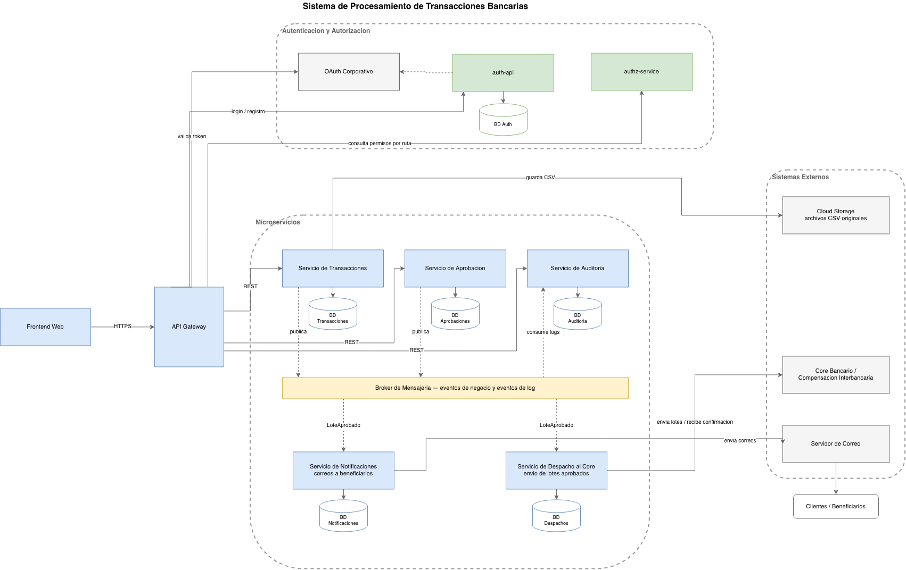

La arquitectura se organiza en cinco capas. El frontend web es el canal que usan los operadores del banco. El API Gateway es el unico punto de acceso al sistema, de modo que ningun microservicio expone puertos publicos. La capa de autenticacion combina el OAuth corporativo, que emite tokens con vida de 12 horas, con los servicios auth-api y authz-service, que gestionan usuarios, roles y permisos por ruta. La capa de microservicios contiene los servicios de Transacciones, Aprobacion, Auditoria, Notificaciones y Despacho al Core, cada uno con su base de datos independiente y conectados entre si por un broker de mensajeria. Por ultimo estan los sistemas externos, que son el core bancario, el servicio de almacenamiento de archivos y el servidor de correo.

El flujo completo recorre esas capas de la siguiente forma. El operador inicia sesion contra el OAuth corporativo y recibe su token. Toda peticion entra por el Gateway, que valida el token y consulta a authz-service si el rol del usuario tiene permiso sobre la ruta. El maker carga el archivo CSV y el Servicio de Transacciones guarda el original en el almacenamiento de archivos, valida cada linea contra las reglas del negocio y registra el lote en su base. El lote validado entra al flujo de aprobacion de tres pasos, donde el maker lo somete, el checker lo revisa y el authorizer lo autoriza. Al completarse el tercer paso se publica el evento LoteAprobado en el broker. El Servicio de Despacho consume ese evento y envia las transacciones al core bancario con reintentos, mientras el Servicio de Notificaciones envia un correo a cada beneficiario informando que su transaccion esta en proceso. Durante todo el recorrido cada servicio publica eventos de log con un correlation-id unico por peticion y el Servicio de Auditoria los persiste, dejando el historial completo consultable.

## Microservicios y separacion de responsabilidades

El sistema se divide en cinco microservicios y cada uno es dueno exclusivo de su base de datos. Ningun servicio consulta la base de otro y toda comunicacion pasa por REST o por eventos.

El Servicio de Transacciones recibe y parsea los archivos CSV, valida cada linea contra las reglas del negocio como saldo disponible, limites de transaccion, cuentas validas y prevencion de fraude, y mantiene el historial consultable de lotes con la opcion de descargar el archivo original.

El Servicio de Aprobacion controla el flujo maker checker authorizer y el estado de cada lote dentro del proceso. Expone las operaciones de someter, revisar, autorizar y rechazar, y al completarse el tercer paso publica el evento LoteAprobado.

El Servicio de Despacho al Core consume ese evento y envia los lotes aprobados al core bancario externo, registrando cada intento y conciliando las confirmaciones que el core devuelve.

El Servicio de Notificaciones consume el mismo evento y envia un correo a cada beneficiario del lote, guardando el registro de cada envio con su estado.

El Servicio de Auditoria recibe los eventos de log de todos los demas servicios y los persiste para que los auditores puedan consultarlos y descargarlos.

Esta division responde a que las piezas escalan a ritmos distintos y fallan por causas distintas. En fin de mes la carga fuerte cae sobre Transacciones, que puede escalar a varias replicas sin duplicar el resto del sistema. Despacho y Notificaciones dependen de terceros, asi que si el core esta caido el evento espera en la cola y solo ese servicio reintenta mientras la carga y aprobacion de lotes nuevos sigue funcionando. Auditoria escribe mas que todos los demas juntos y con base propia su crecimiento no degrada las bases transaccionales. Ademas validar reglas del negocio y controlar quien aprueba que son procesos con reglas, usuarios y ciclos de cambio diferentes, y mezclarlos en un solo servicio violaria la responsabilidad unica a nivel de servicio.

## Propuesta de API Gateway

El API Gateway se despliega como unico punto de entrada del sistema. Expone una sola URL publica y dirige cada ruta al microservicio correspondiente. Valida la firma y la expiracion del token OAuth en el borde, de modo que una peticion sin token valido nunca llega a un microservicio, y delega en authz-service la decision de si el rol puede acceder a la ruta. Aplica rate limiting por usuario para proteger a los servicios en los picos de demanda, inyecta el correlation-id que sostiene la trazabilidad del logging y centraliza TLS y CORS, que antes estaban repartidos en cada servicio.

## Integracion del servicio de autenticacion

La autenticacion queda repartida en dos piezas que se complementan. El OAuth corporativo es la fuente de identidad. Emite los access tokens con vida de 12 horas mediante el flujo Authorization Code, el operador se autentica una vez al inicio de su jornada y el Gateway valida ese token en cada peticion.

Los servicios auth-api y authz-service aportan la gestion de permisos y accesos. auth-api administra el registro de usuarios con sus datos cifrados y vincula la identidad corporativa con el usuario local y su rol. authz-service decide si un rol puede acceder a una ruta. Como esa politica vive en una tabla de datos y no en condicionales, extenderla a los roles nuevos solo requiere agregar entradas sin tocar la logica ya probada. El maker puede cargar archivos y ver sus lotes, el checker revisa en el segundo paso, el authorizer autoriza o rechaza en el tercero, el administrador gestiona usuarios y roles y el auditor consulta los logs y el historial completo.

El flujo por peticion queda asi. El Gateway valida el token OAuth, consulta a authz-service con el rol y la ruta y si esta permitido enruta la peticion al microservicio. La llamada hacia authz-service conserva reintentos con backoff exponencial para tolerar fallas transitorias.

## Comunicacion entre servicios

Se combinan dos estilos segun la necesidad de respuesta. Lo que el operador necesita ver de inmediato viaja por REST sincrono a traves del Gateway, como la carga del CSV con su resultado de validacion, las acciones de aprobacion y las consultas de historial y de logs.

Los procesos que no deben bloquear al operador ni depender de que un tercero este disponible viajan por mensajeria asincrona a traves del broker. El evento lote.aprobado lo publica Aprobacion al completar el tercer paso y lo consumen Despacho y Notificaciones desde colas independientes, cada uno a su ritmo. El evento log.evento lo publican todos los servicios y lo consume Auditoria. Cada cola trabaja con confirmacion por mensaje, de modo que si el envio al core falla el mensaje no se pierde, se reintenta y tras agotar los reintentos pasa a una dead letter queue para revision manual.

## Modelo entidad relacion por microservicio

Cada microservicio tiene su propio esquema y ningun esquema comparte tablas con otro. Cuando un servicio necesita referirse a un dato de otro guarda solo el identificador como referencia logica, sin clave foranea entre bases, de modo que cada base puede evolucionar y escalar por separado.

En la base de Transacciones queda el archivo CSV original con su ruta en el almacenamiento y su hash de integridad, el lote que se genero de el, cada linea como transaccion y el resultado de cada regla de validacion aplicada.

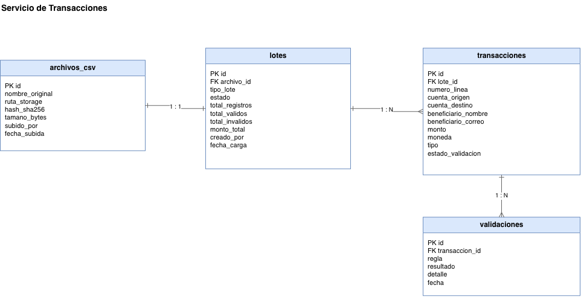

La base de Aprobaciones guarda la solicitud de aprobacion de cada lote y el registro de quien ejecuto cada paso, con que accion, comentario y fecha.

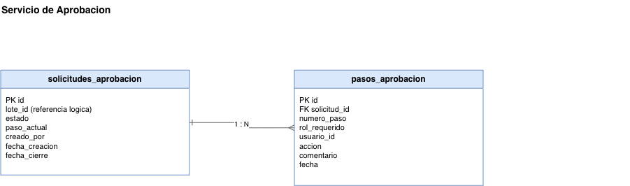

La base de Despachos registra el envio de cada lote al core, cada intento con su resultado y las confirmaciones recibidas para la conciliacion.

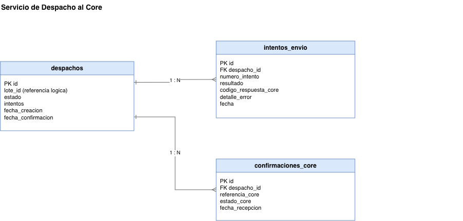

La base de Notificaciones guarda una notificacion por transaccion del lote con su destinatario y el estado del envio, junto a las plantillas de correo.

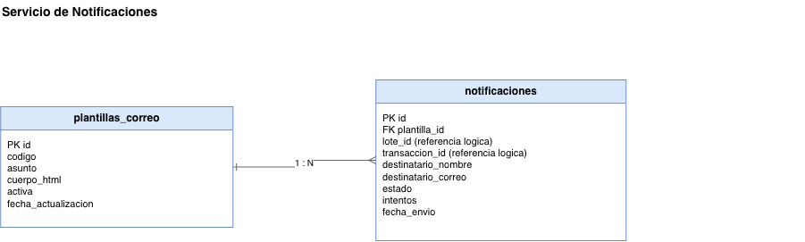

La base de Auditoria almacena todos los eventos del sistema con su correlation-id y su detalle completo, ademas de los exportes descargables que generan los auditores.

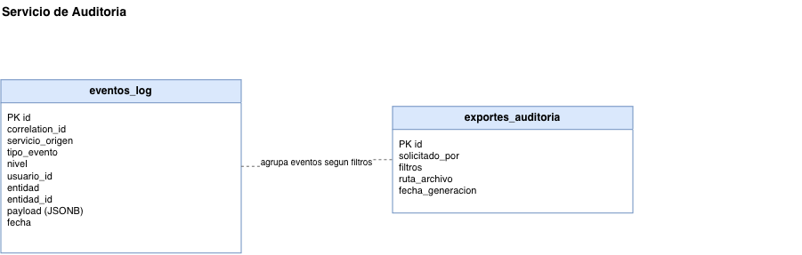

## Almacenamiento de archivos CSV

Se separa el archivo fisico de su contenido procesado. El CSV original se guarda inmutable en un almacenamiento de objetos como evidencia y su contenido parseado vive en la base de Transacciones para consulta y validacion.

Cuando el maker sube un archivo el servicio calcula su hash SHA-256 y verifica que no sea un duplicado ya cargado. Luego sube el original al almacenamiento, registra la ruta, el hash, el tamano y quien lo subio, y recien entonces parsea el contenido, aplica las reglas de validacion linea por linea y registra el lote con sus transacciones. El archivo almacenado nunca se modifica ni se borra.

El almacenamiento se organiza por anio, mes y lote, con lo que la busqueda desde el historial es directa y no hay colisiones entre archivos distintos con el mismo nombre. Solo el Servicio de Transacciones tiene credenciales de escritura. Las descargas desde el historial se hacen con URLs prefirmadas de expiracion corta, el contenido se cifra en reposo y viaja por TLS, el versionado esta activado y los archivos pasan a almacenamiento frio despues de 90 dias, conservandose el plazo que exija la normativa bancaria.

## Diagramas de clases por microservicio

Los cinco servicios comparten una misma estructura de capas. Un controller o consumer maneja la entrada por HTTP o por mensajes del broker, un service concentra la regla de negocio y una interfaz de repositorio con su implementacion concreta resuelve la persistencia. Los services dependen de interfaces y las implementaciones concretas se inyectan al armar la aplicacion. Las reglas de validacion implementan una interfaz comun, de modo que agregar una regla nueva no modifica el motor de validacion, y la definicion de pasos del flujo de aprobacion vive como datos en la politica de flujo. Las clases de dominio de cada diagrama corresponden una a una con las entidades del modelo ER de su servicio.

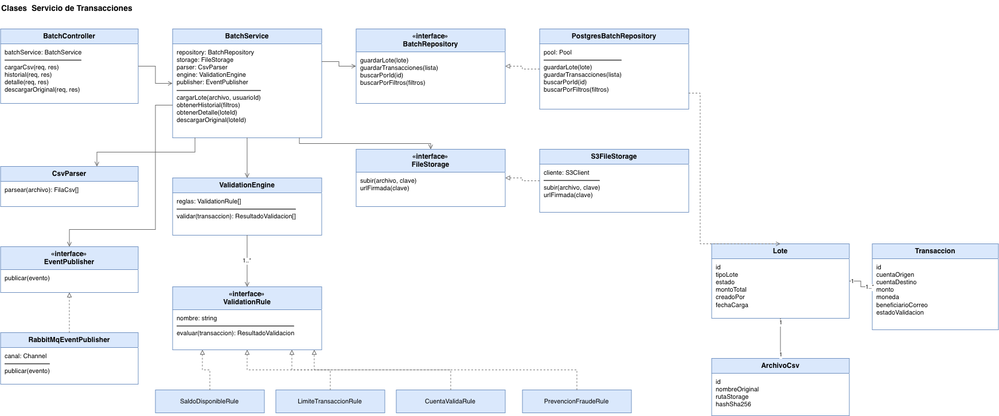

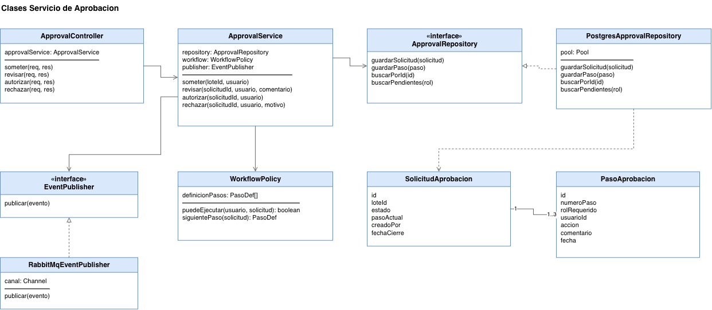

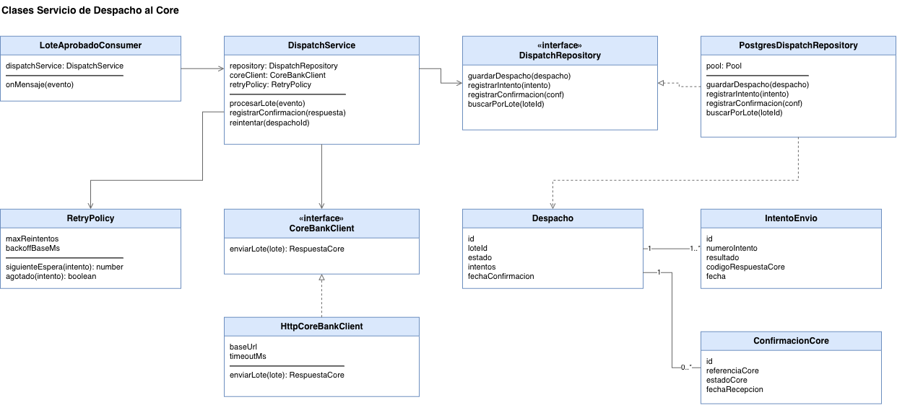

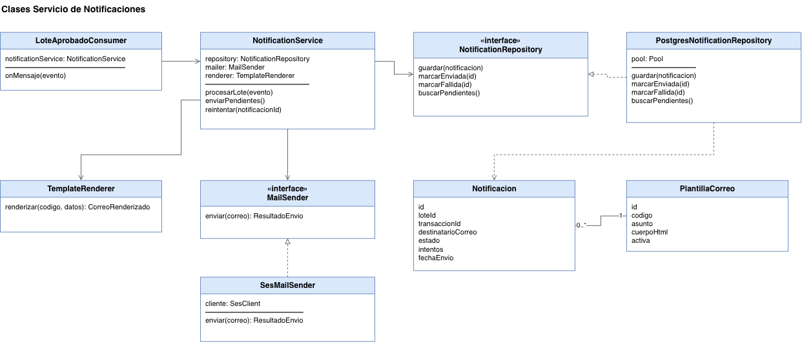

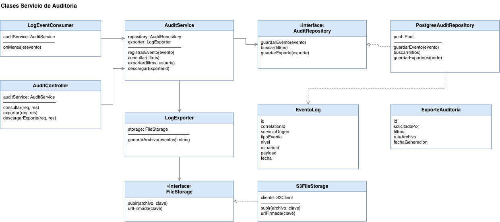

## Flujo de aprobacion de 3 pasos

El flujo sigue el esquema maker checker authorizer, en el que tres personas distintas intervienen antes de que el dinero se mueva. En el primer paso el maker somete al flujo un lote ya validado y la solicitud queda pendiente de revision. En el segundo el checker revisa el contenido del lote y la solicitud queda pendiente de autorizacion. En el tercero el authorizer autoriza el envio definitivo y el lote queda aprobado.

La politica de flujo verifica en cada paso que el usuario no haya participado en un paso anterior del mismo lote, de modo que aunque una persona tenga dos roles no puede ejecutar dos pasos sobre el mismo lote. Cada paso solo se acepta si la solicitud esta en el estado que le corresponde, por lo que no se puede autorizar un lote que no fue revisado. El checker o el authorizer pueden rechazar con un comentario, en cuyo caso la solicitud queda rechazada, el flujo termina y el lote nunca llega al core, asi que el maker debe corregir y cargar un lote nuevo. Al registrarse el tercer paso se publica el evento LoteAprobado y a partir de ahi el envio al core y los correos ocurren sin intervencion de ningun operador. Cada paso guarda usuario, accion, comentario y fecha, ademas del evento de log que consume Auditoria.

## Diagramas de secuencia

El primer flujo critico recorre los tres pasos de aprobacion a traves del Gateway, con la validacion de segregacion en el segundo y tercer paso, hasta la publicacion de LoteAprobado.

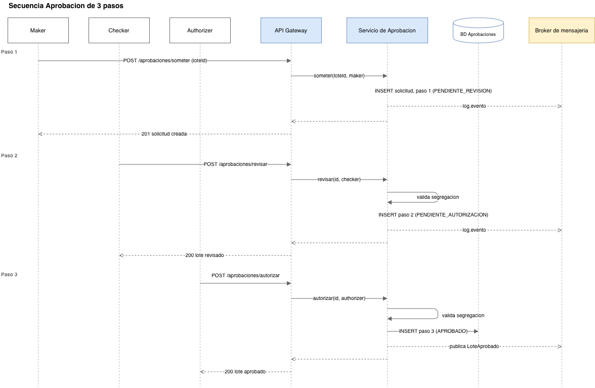

El segundo muestra el envio al core bancario con el camino de confirmacion exitosa y el de error, que reintenta con backoff y termina en la dead letter queue si se agotan los reintentos.

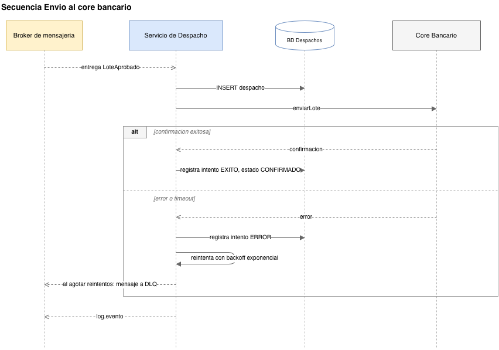

El tercero recorre la notificacion a los clientes transaccion por transaccion hasta el correo que recibe el beneficiario.

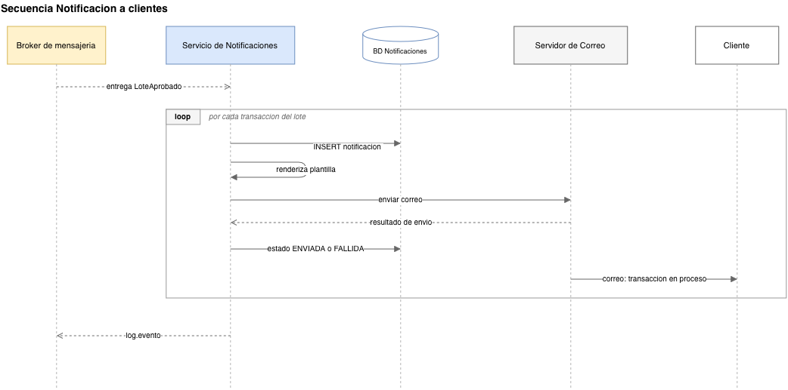

## Diagrama de componentes

El diagrama muestra la relacion entre los microservicios, el API Gateway y los sistemas externos, con cada dependencia etiquetada con la interfaz que la conecta. El Gateway consume las interfaces REST de los servicios y las de los servicios de autenticacion y autorizacion. Los servicios se conectan entre si unicamente a traves de las colas del broker y los sistemas externos se consumen por sus interfaces propias. Aqui no aparecen las bases de datos porque el foco es el acoplamiento entre componentes, que deja visible que ningun microservicio depende directamente de otro.

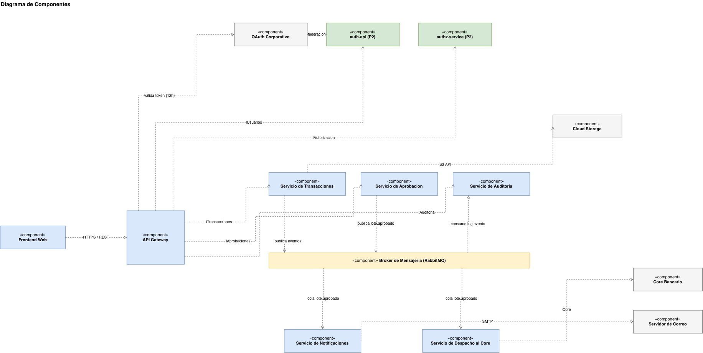

## Logging centralizado

El logging se resuelve con el mismo broker que la mensajeria de negocio. Cada servicio publica sus eventos en la cola log.evento y el Servicio de Auditoria es el unico que los persiste, en su propia base. El Gateway genera un correlation-id por peticion y lo propaga en los headers y en cada evento publicado, con lo que se puede reconstruir el camino completo de una peticion a traves de todos los servicios. Publicar un log es asincrono, asi que si Auditoria esta caida los eventos esperan en la cola y ningun flujo de negocio se detiene.

Se registran los eventos de negocio como la carga de un lote, cada paso de aprobacion, cada envio al core y cada correo, y los eventos tecnicos como errores y reintentos, con su nivel, su usuario, su servicio de origen y el detalle completo del evento. La tabla de eventos solo acepta inserciones, sin actualizaciones ni borrados, lo que la hace auditable. Los auditores consultan a traves del Gateway con filtros por fecha, servicio, usuario, nivel y correlation-id y pueden generar exportes descargables. La tabla se particiona por mes con indices por correlation-id, servicio y fecha, y las particiones antiguas se archivan en almacenamiento frio, alineado con la retencion de los archivos CSV.

## Tecnologias y patrones

Los microservicios se implementarian con Node.js, TypeScript y Express para mantener un solo lenguaje en todo el sistema, tipado estatico y continuidad con los servicios de autenticacion ya construidos. La persistencia usa PostgreSQL con una base independiente por servicio. Como API Gateway se propone Kong, por ser open source, no atar la solucion a un proveedor de nube y traer ya resueltos la validacion OAuth, el rate limiting y la inyeccion de correlation-id. Como broker de mensajeria se propone RabbitMQ frente a Kafka, porque el patron dominante del sistema son colas de trabajo con confirmacion individual, reintentos y dead letter queues que RabbitMQ resuelve de forma nativa con una operacion mas simple, mientras que Kafka rinde mas en streaming de volumen extremo que no es el cuello de botella de este caso. Para los archivos se propone AWS S3 frente a un servidor FTP propio, porque la durabilidad, el versionado, el cifrado y el ciclo de vida ya vienen gestionados y un FTP exigiria administrar el servidor, sus discos, sus respaldos y su seguridad manualmente. Docker y Kubernetes son opcionales en el enunciado, pero el diseno los contempla para escalar horizontalmente el Servicio de Transacciones en los picos de demanda.

En cuanto a patrones, la solucion aplica API Gateway como unico punto de entrada con la seguridad centralizada, una base de datos por servicio para que cada pieza despliegue y escale por separado, comunicacion dirigida por eventos para desacoplar la aprobacion del despacho y de las notificaciones, el esquema maker checker authorizer como segregacion de funciones, reintentos con backoff exponencial y dead letter queues para tolerar fallas transitorias sin perder mensajes, y un correlation-id por peticion como base de la trazabilidad. Los principios SOLID se mantienen en todos los servicios, con services que dependen de interfaces y politicas que viven como datos en lugar de condicionales.
