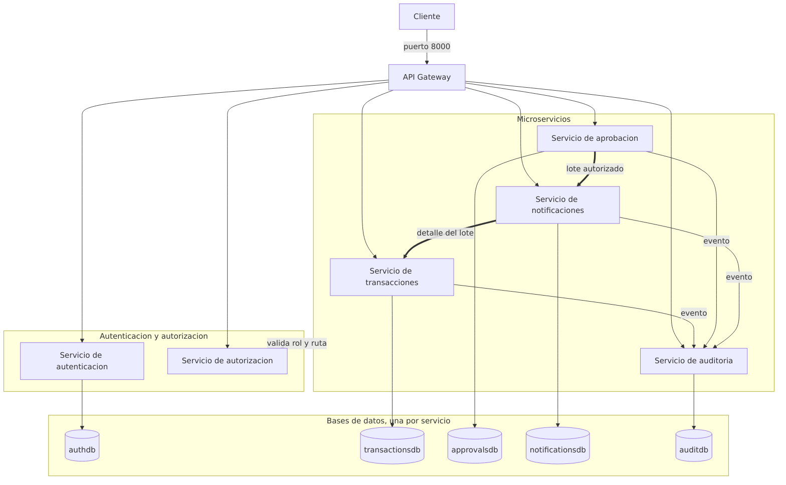
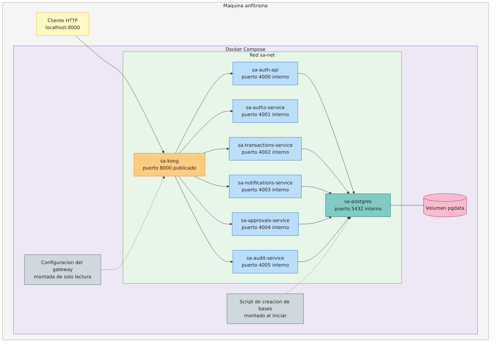
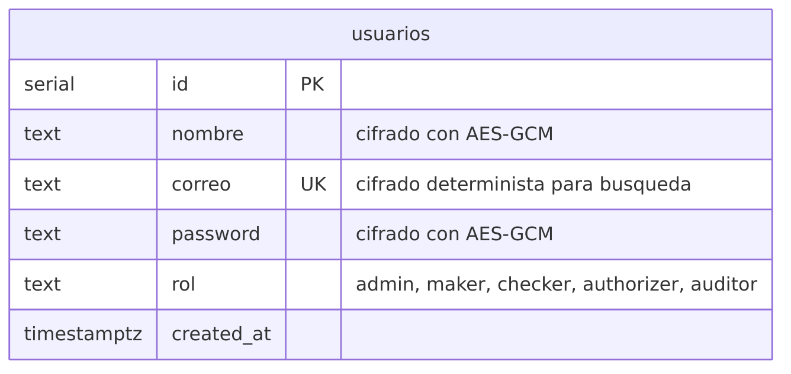
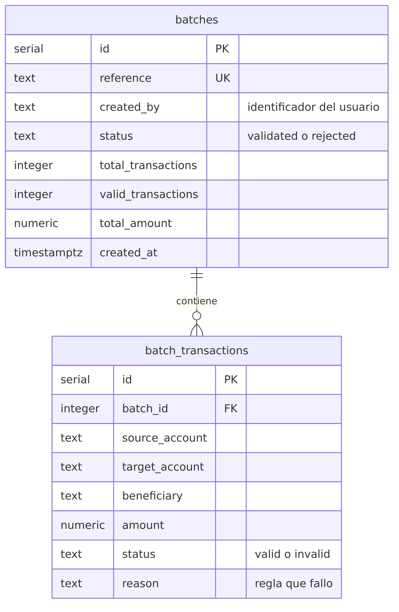
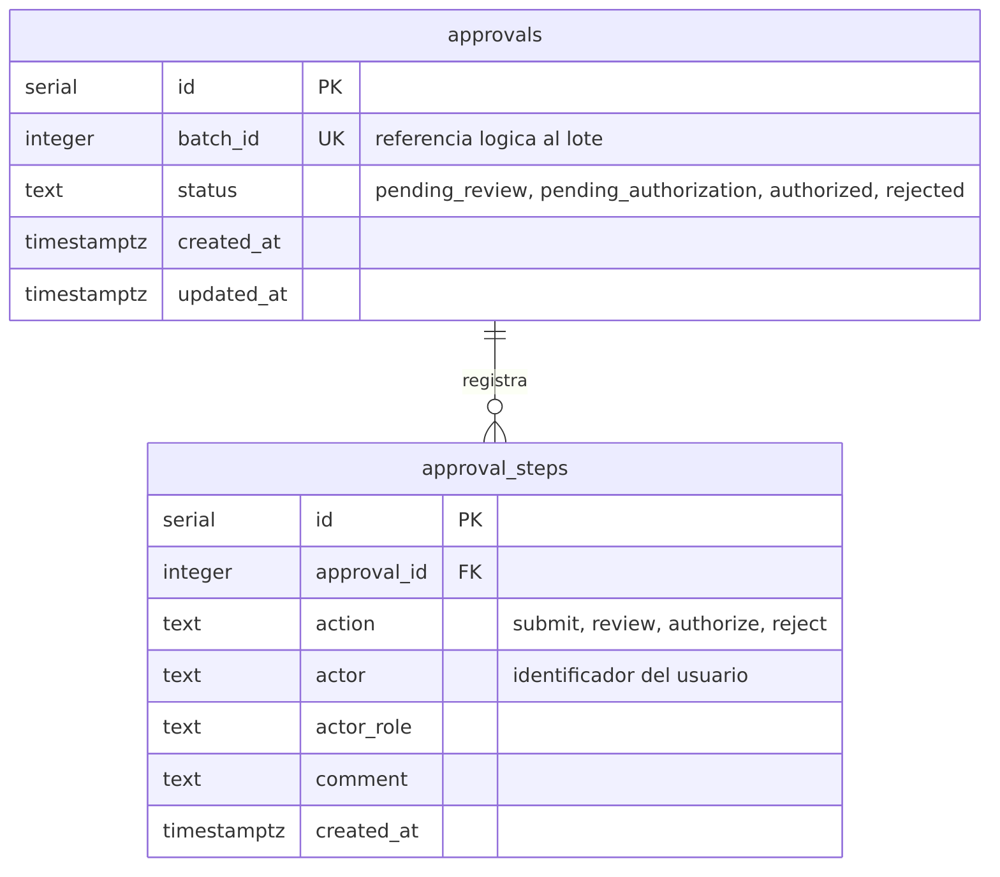
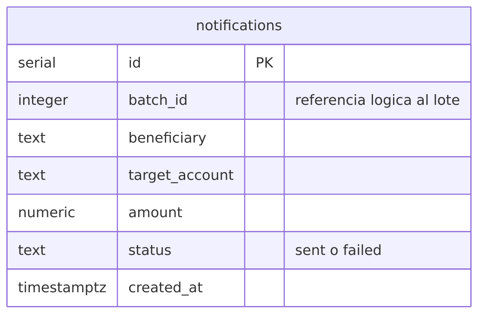
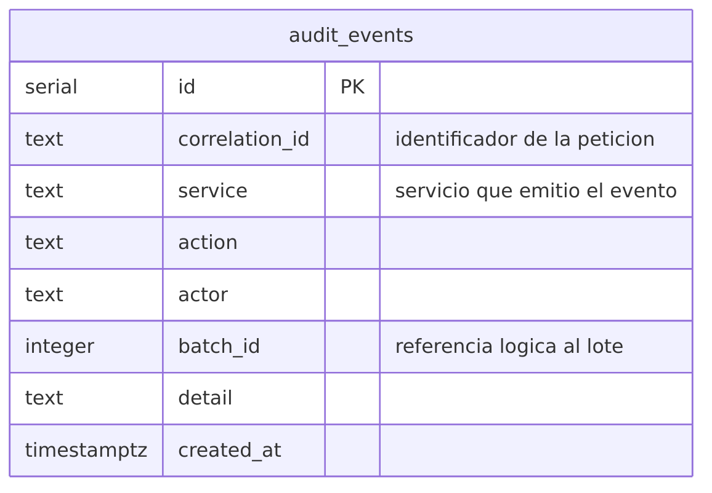

# Practica 4 Diseno y toma de decisiones

Sistema de procesamiento de lotes de transacciones bancarias construido con microservicios. Un operador carga un lote de transacciones, el sistema las valida, el lote pasa por un flujo de aprobacion de tres pasos, al autorizarse se notifica a cada beneficiario y todo el recorrido queda registrado para auditoria.

## Como levantar el sistema

Con Docker en ejecucion, desde la carpeta P4:

```
docker compose up --build
```

Ese unico comando construye las imagenes, crea las bases de datos, aplica los esquemas y deja el sistema respondiendo en http://localhost:8000.

Al arrancar, el servicio de autenticacion crea un usuario por cada rol con la contraseña Practica4, de modo que el sistema queda usable de inmediato. Los correos son admin@sa.gt, maker@sa.gt, checker@sa.gt, authorizer@sa.gt y auditor@sa.gt.

Para detener y borrar los datos:

```
docker compose down -v
```

## Arquitectura



El sistema se divide en microservicios de negocio y servicios de identidad, todos detras de un API Gateway que es el unico punto de entrada.

El servicio de transacciones recibe los lotes, valida cada transaccion contra las reglas del negocio y guarda el resultado. El servicio de aprobacion controla el flujo donde un usuario somete el lote, otro lo revisa y un tercero lo autoriza. El servicio de notificaciones registra el aviso que se envia a cada beneficiario del lote autorizado. El servicio de auditoria recibe los eventos de los demas y permite consultarlos.

A ellos se suman el servicio de autenticacion, que registra usuarios y emite el token, y el servicio de autorizacion, que decide si un rol puede acceder a una ruta.

Cada servicio es dueño exclusivo de su base de datos. Ninguno consulta la base de otro, y cuando necesita un dato ajeno lo pide por HTTP o guarda solo el identificador como referencia logica, sin llave foranea entre bases. Esa es la separacion que permite que cada base evolucione por su cuenta.

## Lenguajes y GraphQL

Los servicios de transacciones, notificaciones, autenticacion y autorizacion estan en Node con TypeScript. Los de aprobacion y auditoria estan en Python con FastAPI.

GraphQL esta implementado en aprobacion y en auditoria. Aprobacion expone la mutacion registerStep, que mueve el flujo, y la consulta approval, que devuelve el estado con su historial de pasos. Auditoria expone la consulta events, que filtra por lote, por servicio o por correlation id. Los esquemas estan en contracts.

Se eligio GraphQL para esos dos porque son los servicios donde el cliente necesita partes distintas del mismo dato. En una consulta de aprobacion a veces basta el estado y a veces se necesita el historial completo con quien ejecuto cada paso, y con GraphQL eso se resuelve con una sola ruta en lugar de varios endpoints.

## Despliegue



Cada servicio tiene su propio Dockerfile. Los de Node usan construccion en dos etapas: la primera compila TypeScript y la segunda copia solo el resultado con las dependencias de produccion, lo que deja una imagen mas liviana y sin herramientas de compilacion.

Todos los contenedores viven en la red sa-net y solo el gateway publica un puerto hacia la maquina anfitriona. Un microservicio no es alcanzable desde afuera, lo que se comprueba facil: una peticion directa al puerto interno de un servicio no obtiene respuesta, y la misma peticion por el puerto del gateway si.

Los servicios que usan base de datos esperan a que PostgreSQL reporte estar sano antes de arrancar, mediante la condicion service_healthy del compose, para que no fallen al iniciar mas rapido que la base.

## API Gateway

El gateway es Kong en modo declarativo, sin base de datos propia. Toda su configuracion vive en gateway/kong.yml, que se monta en el contenedor de solo lectura. No requiere escribir codigo y queda versionado en el repositorio como cualquier otro archivo.

Kong enruta por prefijo. Las rutas de registro y sesion van al servicio de autenticacion, la ruta de autorizacion al servicio que decide permisos, y los prefijos transactions, approvals, notifications y audit van a su servicio correspondiente. Como cada servicio ya expone sus rutas con el prefijo completo, las rutas de Kong llevan strip_path en false para que no recorte el prefijo antes de reenviar.

El gateway tambien inyecta un correlation id en cada peticion que no lo traiga, con el plugin correlation-id. Ese identificador viaja por toda la cadena de servicios y es el que permite reconstruir la traza completa de un lote en auditoria.

## Autenticacion y autorizacion

El servicio de autenticacion guarda a los usuarios con el nombre y la contraseña cifrados con AES-GCM y el correo cifrado de forma determinista, para poder buscarlo sin descifrar toda la tabla. El login devuelve el token en una cookie HttpOnly y tambien en el cuerpo de la respuesta, porque aqui los clientes son herramientas de API y otros servicios, no solo un navegador.

El servicio de autorizacion decide si un rol puede acceder a una ruta. La politica vive en una estructura de datos y no en condicionales, asi que agregar un rol o una ruta es agregar una entrada.

El control queda en dos niveles. Antes de entrar, cada microservicio verifica la firma del token y consulta al servicio de autorizacion si ese rol puede acceder a su ruta. Ya adentro, el servicio aplica sus propias reglas de negocio: en el flujo de aprobacion un maker puede someter pero no revisar, aunque tenga permiso de entrar al servicio.

Los roles son admin, maker, checker, authorizer y auditor.

## Comunicacion entre servicios

Ademas de lo que entra por el gateway, hay llamadas directas entre servicios.

Cuando el lote llega a autorizado, aprobacion llama a notificaciones. Notificaciones le pide a transacciones el detalle del lote para saber a quien avisar, y solo genera notificacion para las transacciones validas. Transacciones, aprobacion y notificaciones reportan cada accion a auditoria.

Las llamadas hacia auditoria y hacia notificaciones no interrumpen la operacion. Si esos servicios estan caidos, el lote se crea y se aprueba igual y el error solo queda en el log, porque auditar y notificar no pueden bloquear al negocio. En cambio la consulta al servicio de autorizacion si es bloqueante, porque de ella depende si la peticion tiene permiso, y se hace con reintentos y espera exponencial para tolerar fallas pasajeras.

## Modelo de datos

Cada servicio tiene su base y ninguna comparte tablas con otra.











## Contrato de los microservicios

En contracts esta la coleccion de Postman con las peticiones del sistema, ordenadas como flujo ejecutable. Los logins guardan su token en variables y crear el lote guarda su identificador, asi que la coleccion corre de principio a fin sin ajustar nada a mano. Todas las peticiones apuntan al gateway.

La misma coleccion esta tambien en formato Bruno, con las operaciones GraphQL como consultas nativas. Los esquemas GraphQL de los servicios que lo implementan estan en el mismo directorio.

## Principios SOLID aplicados

### Responsabilidad unica

Cada clase tiene un solo motivo para cambiar. En el servicio de transacciones, validar y guardar son responsabilidades separadas: TransactionValidator solo decide si una transaccion cumple las reglas, PostgresBatchRepository solo sabe de SQL y BatchService coordina a ambos sin conocer ni las reglas ni las consultas.

```typescript
export class TransactionValidator {
  constructor(private readonly rules: ValidationRule[]) {}

  validate(transaction: TransactionInput): ValidatedTransaction {
    const failed = this.rules.find((rule) => !rule.isSatisfiedBy(transaction));

    return failed
      ? { ...transaction, status: "invalid", reason: failed.reason }
      : { ...transaction, status: "valid", reason: null };
  }
}
```

Si cambia el motor de base de datos se toca el repositorio, si cambia una regla del negocio se toca una regla, y el servicio no se entera de ninguno de los dos cambios. El archivo es services/transactions-service/src/validation/transaction-validator.ts.

### Abierto cerrado

El validador esta abierto a nuevas reglas y cerrado a modificacion. Las reglas cumplen una interfaz comun y el validador solo las recorre, sin saber cuantas son ni que evalua cada una.

```typescript
export interface ValidationRule {
  readonly reason: string;
  isSatisfiedBy(transaction: TransactionInput): boolean;
}

export class AmountLimitRule implements ValidationRule {
  readonly reason = "monto_excede_limite";

  constructor(private readonly limit: number) {}

  isSatisfiedBy(transaction: TransactionInput): boolean {
    return transaction.amount <= this.limit;
  }
}
```

Las reglas actuales revisan el formato de la cuenta, que la cuenta de origen y la de destino sean distintas, que el monto sea positivo y que no exceda el limite permitido. Agregar otra, por ejemplo una lista de cuentas bloqueadas, es escribir una clase nueva y sumarla a la lista en app.ts. El codigo del validador, que ya esta probado, no se toca. Los archivos son validation/validation-rule.ts y validation/rules.ts.

### Sustitucion de Liskov

Donde se espera una abstraccion, cualquier implementacion suya funciona sin romper al que la usa. En el servicio de autenticacion la interfaz Cipher tiene dos implementaciones que se usan de forma intercambiable.

```typescript
export interface Cipher {
  encrypt(plainText: string): string;
  decrypt(cipherText: string): string;
}
```

AesRandomCipher usa AES-GCM con vector de inicializacion aleatorio, asi que el mismo texto produce un cifrado distinto cada vez, y se usa para el nombre y la contraseña. AesDeterministicCipher deriva el vector del propio texto, asi que el mismo correo siempre produce el mismo cifrado y se puede buscar en la base. UserService recibe ambas como Cipher y las usa igual, sin preguntar cual es cual. Los archivos estan en services/auth-api/src/crypto.

### Segregacion de interfaces

Ningun cliente depende de metodos que no usa. En vez de una interfaz grande de comunicacion entre servicios, hay varias pequeñas y cada una tiene el metodo que su consumidor necesita.

```typescript
export interface AuditClient {
  record(event: AuditEvent): Promise<void>;
}

export interface BatchClient {
  findTransactions(batchId: number, token: string): Promise<BatchTransaction[]>;
}

export interface AuthorizationClient {
  authorize(token: string, route: string): Promise<AuthorizationDecision>;
}
```

El servicio de transacciones depende solo de AuditClient, porque es lo unico que consume. Notificaciones depende de AuditClient y de BatchClient. Si mañana auditoria expone una operacion de consulta, esa firma no aparece en los servicios que solo escriben eventos.

### Inversion de dependencias

Las clases de negocio dependen de abstracciones y las implementaciones concretas se inyectan desde afuera. BatchService recibe un repositorio, un validador y un cliente de auditoria, y no construye ninguno.

```typescript
export class BatchService {
  constructor(
    private readonly repository: BatchRepository,
    private readonly validator: TransactionValidator,
    private readonly auditClient: AuditClient,
  ) {}
```

El armado ocurre en un solo lugar, la funcion createApp de app.ts, que es la unica que conoce las clases concretas.

```typescript
const repository = new PostgresBatchRepository(pool);
const auditClient = new HttpAuditClient(env.auditServiceUrl, "transactions-service");
const service = new BatchService(repository, validator, auditClient);
```

Gracias a eso, cambiar PostgreSQL por otro motor o el envio de eventos por HTTP por una cola de mensajes es escribir una clase nueva y cambiar esa linea, sin tocar la logica del negocio. El mismo patron se repite en Python, donde ApprovalService recibe su repositorio y sus clientes por constructor.

## Repaso teorico

### Sobre microservicios

Un microservicio es un servicio pequeño y desplegable por si solo, dueño de sus datos y responsable de una capacidad del negocio. La diferencia con un monolito no es el tamaño del codigo sino la independencia: aqui se puede reconstruir y reiniciar el servicio de notificaciones sin tocar el de transacciones.

La ventaja principal en este sistema es el aislamiento de fallas y el escalado por partes. Si el servicio de auditoria se cae, los lotes se siguen creando y aprobando. Si en fin de mes crece la carga de lotes, se replica solo transacciones.

El costo es real y hay que reconocerlo. Hay mas piezas que operar, la comunicacion pasa por la red y puede fallar, y no existe una transaccion unica que abarque varias bases, asi que la consistencia entre servicios es eventual.

Cada servicio tiene su base porque compartir una sola volveria a acoplarlos: un cambio de esquema obligaria a coordinar despliegues y una consulta pesada de un servicio degradaria a los demas.

### Sobre Docker

Una imagen es la plantilla inmutable con el sistema de archivos y las dependencias, y un contenedor es una instancia en ejecucion de esa imagen. De una imagen se pueden levantar varios contenedores.

El Dockerfile describe como se construye la imagen, paso por paso. Docker Compose describe como se orquestan varios contenedores juntos: sus variables, su red, sus volumenes y el orden en que arrancan.

La construccion en dos etapas sirve para no cargar en la imagen final las herramientas que solo se usan al compilar. Aqui la primera etapa instala todas las dependencias y compila TypeScript, y la segunda copia solo el resultado y las dependencias de produccion.

Los datos de PostgreSQL viven en un volumen porque el sistema de archivos de un contenedor es efimero: al recrearlo se pierde lo que tenga adentro, y el volumen sobrevive.

### Sobre GraphQL

GraphQL expone un solo punto de entrada donde el cliente describe con exactitud los datos que quiere. En REST el servidor decide la forma de la respuesta y el cliente recibe lo que haya, de ahi que sobren o falten datos y aparezcan varias llamadas para armar una vista.

Un esquema define los tipos y las operaciones disponibles, y esta escrito de forma que el cliente puede consultarlo. Una query lee datos y una mutation los modifica.

En este sistema la consulta de una aprobacion sirve de ejemplo: pedir solo el estado o pedir el estado con todo el historial de pasos son la misma ruta y el mismo resolver, y el cliente decide cuanto quiere.

GraphQL no reemplaza a REST en todo. Para operaciones simples como crear un lote o consultar por identificador, REST es mas directo y aprovecha mejor los codigos de estado y el cache de HTTP. Por eso conviven en este sistema.

## Estructura del repositorio

```
P4
├── contracts             colecciones de peticiones y esquemas GraphQL
├── database              script que crea las bases
├── diagramas             fuentes de los diagramas y sus exportaciones en PNG
├── gateway               configuracion declarativa de Kong
├── services              un directorio por microservicio, cada uno con su Dockerfile
└── docker-compose.yml    levanta todo el sistema
```
