# Evidencias de funcionamiento

La direccion publica del sistema es 35.193.64.224 en el puerto 8000.

## El cluster existe en la nube y no es local

El cluster sa-p6 aparece en la consola del proveedor, en la zona us-central1-a, con tres nodos en ejecucion.

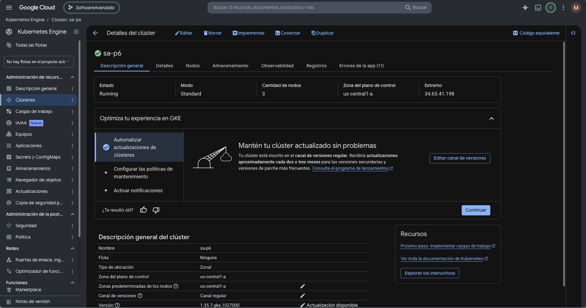

## Los nodos estan disponibles

Los tres nodos responden y ejecutan la version de Kubernetes que administra el proveedor.

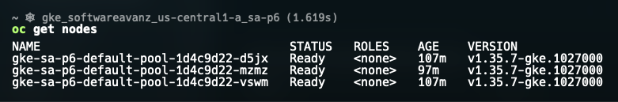

## kubectl apunta al cluster remoto

El contexto activo corresponde al cluster de Google y no a uno local.

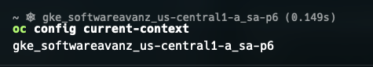

## Las imagenes estan publicadas en un registro privado

El repositorio sa-platform aparece en la consola del proveedor con las cinco imagenes de la plataforma. Es privado, de modo que solo el proyecto puede descargarlas.

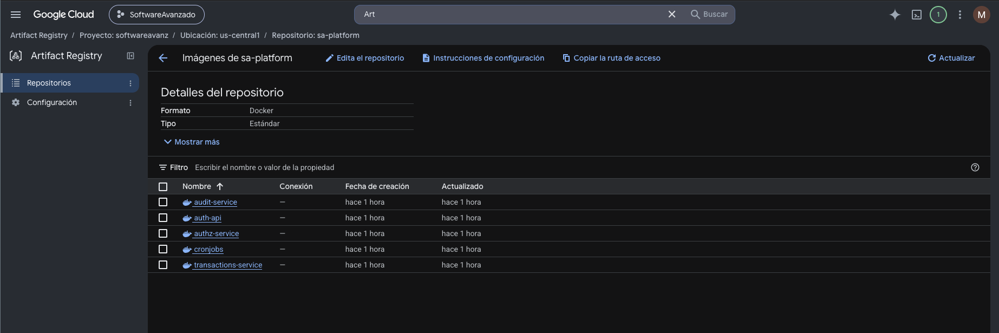

## El cluster descarga las imagenes sin errores

Los pods usan las rutas del registro y ninguno queda en estado de fallo de descarga.

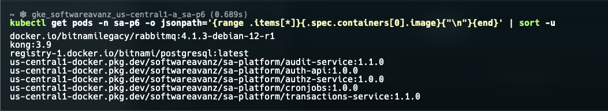

## La plataforma completa esta en ejecucion

Los cuatro microservicios, el API Gateway, la base de datos, el broker y los trabajos programados corren dentro del cluster.

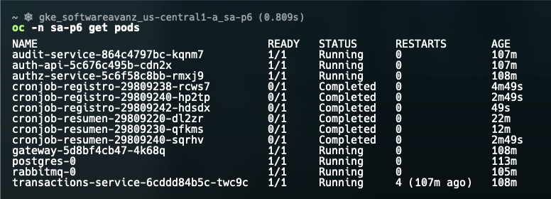

## Las cargas de trabajo estan completas

La consola del proveedor muestra los despliegues, los conjuntos con estado y los trabajos programados de la plataforma, todos en estado correcto.

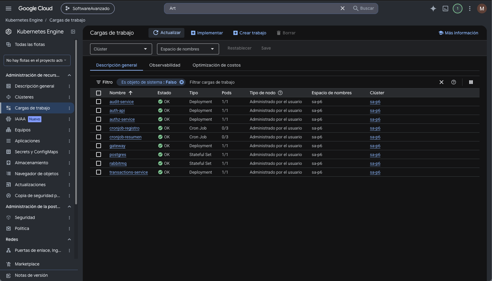

## El sistema tiene una direccion publica

El gateway se expone con un Service de tipo LoadBalancer y el proveedor le asigno una direccion accesible desde internet.

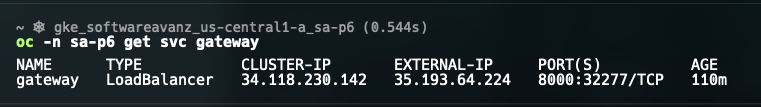

## El proveedor creo un balanceador real

El balanceador existe en la infraestructura de Google, atiende en la direccion publica del sistema y reparte el trafico entre los tres nodos del cluster.

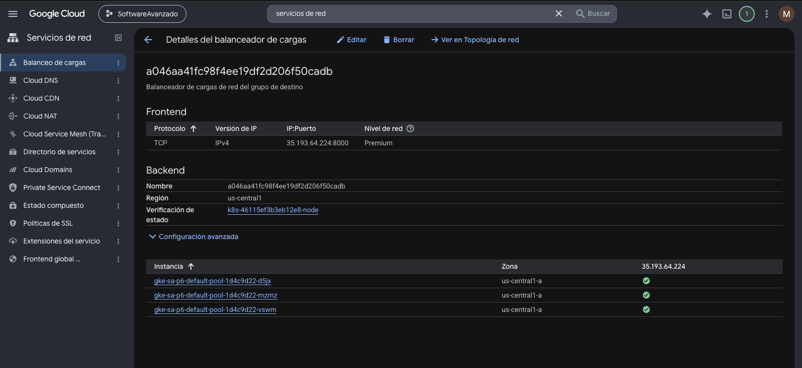

## El almacenamiento usa la clase del proveedor

Los volumenes de la base de datos y del broker se crearon como discos reales de Google.

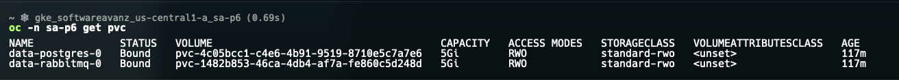

## El sistema responde desde internet

Una peticion de registro de usuario realizada desde fuera del cluster contra la direccion publica.

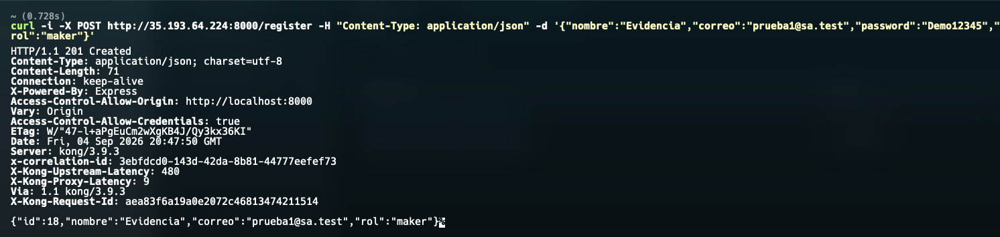

## La autenticacion funciona desde internet

El inicio de sesion devuelve el usuario y su token.

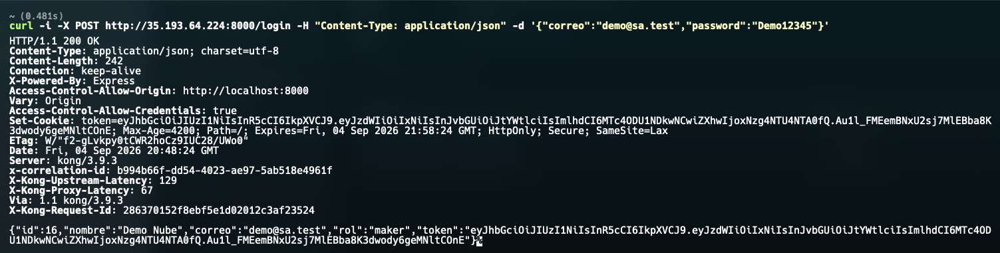

## El gateway es la unica puerta de entrada

Una ruta que no existe es rechazada por el propio gateway, lo que confirma que el trafico entra por el.

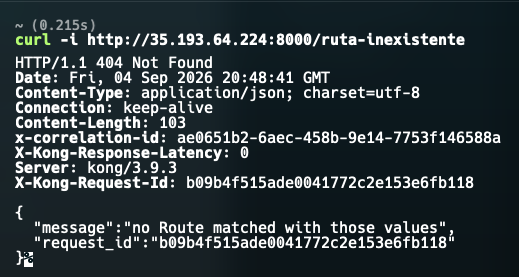

## La comunicacion asincrona funciona

Las colas del broker son durables y el evento publicado al crear un lote llega al servicio de auditoria.

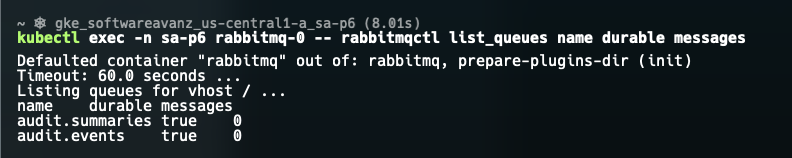

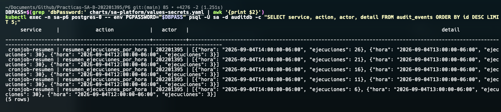

## Los trabajos programados se ejecutan

El primero inserta cada dos minutos la fecha de ejecucion junto al numero de carne 202201395.

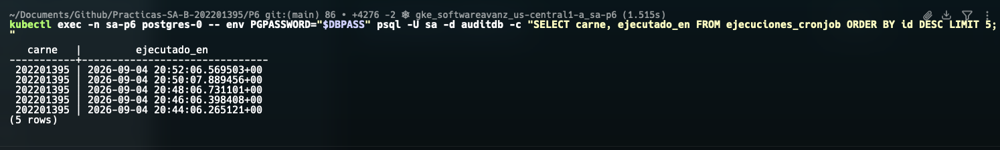
