# Practica 7

Integracion y despliegue continuo.

La plataforma de microservicios tiene un pipeline en GitHub Actions que compila, prueba, construye imagenes, las publica en un registro y despliega al cluster de Kubernetes a partir de un push. El workflow esta en .github/workflows/ci.yml y las imagenes se publican como paquetes publicos en GitHub Container Registry bajo la cuenta jaguzaro.

## Las cuatro etapas

Build compila los tres servicios de TypeScript y valida las dependencias del de Python. Test ejecuta las sesenta y cuatro pruebas unitarias de los cuatro servicios. Dockerizacion construye las cinco imagenes para amd64 y las publica etiquetadas con el hash del commit. Despliegue actualiza el release de Helm en el cluster con esas imagenes.

Cada etapa depende de la anterior. Si una prueba falla no se publica nada, y si nada se publica no se despliega.

## Diagrama del pipeline

```mermaid
graph LR
    subgraph disparadores["Disparadores"]
        rama["Push a rama de caracteristica"]
        principal["Push a rama principal"]
        etiqueta["Etiqueta de version"]
    end

    subgraph build["Build"]
        b_node["Compilar servicios de Node<br/>matriz de 3"]
        b_py["Validar dependencias de Python"]
        artefacto[("Artefacto compilado")]
        b_node --> artefacto
    end

    subgraph test["Test"]
        t_node["Pruebas de Node<br/>matriz de 3, 45 pruebas"]
        t_py["Pruebas de Python<br/>19 pruebas"]
    end

    subgraph docker["Dockerizacion"]
        img["Construir y publicar<br/>matriz de 5 imagenes"]
        registro[("GitHub Container Registry")]
        img --> registro
    end

    subgraph deploy["Despliegue"]
        auth["Autenticacion federada"]
        helm["Upgrade de Helm<br/>espera a los pods"]
        cluster[("Cluster en Google Cloud")]
        auth --> helm --> cluster
    end

    rama --> build
    principal --> build
    etiqueta --> build
    artefacto --> t_node
    b_py --> t_py
    t_node --> img
    t_py --> img
    registro --> auth

    condicion1["Solo rama principal o etiqueta"]
    condicion2["Solo etiqueta"]
    test -.-> condicion1 -.-> docker
    docker -.-> condicion2 -.-> deploy

    classDef almacen fill:#eeeeee,stroke:#555555
    classDef condicion fill:#ffffff,stroke:#999999,stroke-dasharray: 4 3
    class artefacto,registro,cluster almacen
    class condicion1,condicion2 condicion
```

## Organizacion del workflow

Build y test usan una matriz para correr los tres servicios de Node en paralelo. El codigo compilado pasa de build a test como artefacto, porque cada job arranca en una maquina limpia. El servicio de Python tiene jobs propios.

La publicacion usa una matriz de cinco entradas, cada una con el nombre de la imagen y la carpeta de su Dockerfile. Cuando el disparador es una etiqueta de version, la imagen recibe esa version como segunda etiqueta ademas del hash.

El despliegue se autentica contra Google Cloud, obtiene las credenciales del cluster y ejecuta el upgrade de Helm sobrescribiendo las imagenes. El comando espera a que todos los pods respondan y falla si no lo logran en diez minutos, asi el pipeline reporta exito solo cuando la plataforma funciona y no apenas cuando los manifiestos fueron aceptados.

## Versionamiento

Un push a una rama de caracteristica ejecuta solo build y test. Un push a la rama principal agrega la publicacion de imagenes. Una etiqueta de version ejecuta el flujo completo incluido el despliegue.

Llevar codigo al cluster es una decision deliberada que se expresa creando una version. Las condiciones se evaluan sobre la referencia que disparo la ejecucion.

## Autenticacion contra la nube

El runner accede al cluster mediante federacion de identidades, sin ninguna llave almacenada. Google confia en GitHub como emisor de identidades solo para tokens de este repositorio, valida la firma del token que GitHub emite en cada ejecucion y concede credenciales temporales para suplantar a una cuenta de servicio con permiso de desarrollador sobre el cluster. La organizacion de la cuenta bloquea la creacion de llaves de cuenta de servicio, lo que hizo de este el unico camino posible.

## Credenciales de la plataforma

El chart exige contrasenas para instalarse, pero el pipeline no las conoce. El upgrade reutiliza los valores del release existente y sobrescribe unicamente las imagenes, de modo que el pipeline solo decide que version corre cada servicio. El compromiso es que el estado desplegado depende de la historia del release y no se reproduce desde el repositorio solo. La evolucion seria mover las credenciales a un gestor de secretos y referenciarlas por nombre desde el chart.

## Pruebas automaticas

Los servicios de Node usan el ejecutor de pruebas incorporado en Node sobre el codigo compilado. El de Python usa pytest con las dependencias de prueba en un archivo aparte para que no lleguen a la imagen de produccion.

Las pruebas cubren logica pura. En transacciones, las cuatro reglas de validacion con casos parametrizados incluidos los bordes. En autorizacion, la matriz de roles por ruta. En autenticacion, que ambos cifradores recuperan el original y que el determinista es estable mientras el aleatorio no. En auditoria, el verificador de tokens contra firmas incorrectas, expiracion y roles invalidos, y el servicio de registro con un repositorio en memoria en lugar de la base de datos.

## Evidencias

Las capturas de las ejecuciones estan en evidencias.md.

### Que es la integracion continua y que problema resuelve

Es integrar los cambios al repositorio compartido con frecuencia y validar cada integracion automaticamente compilando y probando. Resuelve la integracion tardia, donde los cambios se acumulan en ramas separadas y al juntarlos aparecen conflictos que nadie sabe atribuir. Al integrar seguido cada conflicto es pequeno y reciente, y un cambio que rompe algo se detecta cuando todavia es barato arreglarlo.

### Diferencia entre integracion continua, entrega continua y despliegue continuo

La integracion continua termina cuando el codigo compila y pasa las pruebas. La entrega continua agrega que cada cambio validado queda empaquetado y listo, como una imagen publicada, pero desplegar lo decide una persona. El despliegue continuo elimina esa decision y lleva a produccion todo cambio que supere el pipeline. Aqui un push a la rama principal es entrega continua porque publica sin desplegar, y una etiqueta es despliegue continuo porque llega al cluster sin intervencion.

### Por que las pruebas automaticas son la base de un pipeline

Sin pruebas el pipeline solo verifica que el codigo compile, y compilar no dice nada sobre si el sistema hace lo correcto. Las pruebas convierten al pipeline en una compuerta de calidad, porque un cambio que rompe el comportamiento se detiene antes de producir una imagen. Ademas documentan lo que el sistema promete y permiten refactorizar con confianza.

### Que es un runner efimero y que implica

Es la maquina virtual que GitHub crea para un job y destruye al terminar. Arranca sin codigo, sin dependencias y sin credenciales, y no recuerda ejecuciones anteriores. Obliga a que cada job declare todo lo que necesita y a pasar archivos entre jobs mediante artefactos. A cambio garantiza reproducibilidad, porque nada depende de restos previos, y seguridad, porque nada sensible sobrevive al job.

### Como se autentica un pipeline contra infraestructura externa sin exponer credenciales

Con federacion de identidades. El proveedor de infraestructura se configura para confiar en el emisor de identidades del pipeline, aceptando solo tokens de un repositorio concreto. El pipeline recibe un token firmado que describe su origen, el proveedor lo valida contra las claves publicas del emisor y concede credenciales temporales. Nadie puede falsificar el token sin la clave privada del emisor, y copiar la configuracion a otro repositorio no sirve porque el token declararia otro origen.

### Que papel cumplen las etiquetas de version

Separan integrar de publicar. Un commit es un cambio y una etiqueta declara que ese commit es una version que merece publicarse. Al disparar el despliegue solo con etiquetas, llevar codigo al cluster se vuelve deliberado y cada imagen desplegada queda identificable por su version y por su hash. Eso permite saber que esta corriendo y volver a una version anterior por su nombre.

### Diferencia entre que un despliegue se aplique y que funcione

Aplicarse significa que Kubernetes acepto los manifiestos, y es lo unico que Helm verifica por defecto. Funcionar significa que los pods descargaron sus imagenes, arrancaron y pasaron sus sondas. Entre ambos momentos puede fallar la descarga de una imagen o el arranque de un contenedor, y un pipeline que solo verifica lo primero reporta exito con la plataforma caida. Por eso el despliegue espera a que los pods respondan y falla si no lo logran.
