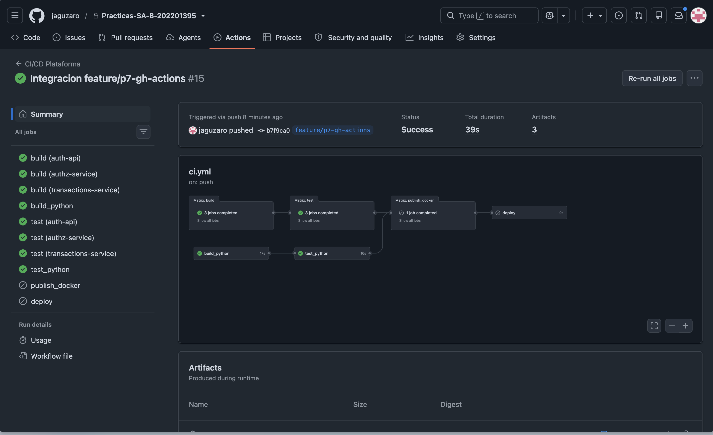
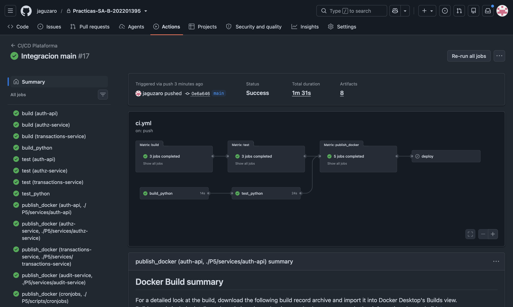
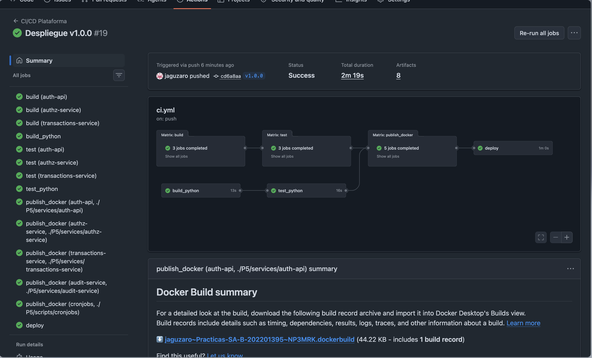

# Evidencias de ejecucion

Las tres capturas muestran el mismo workflow disparado por tres eventos distintos, y como cada uno ejecuta un subconjunto diferente de las etapas.

## Push a una rama de caracteristica

Se ejecutan build y test para los cuatro servicios. La publicacion de imagenes y el despliegue aparecen omitidos, porque ninguna de sus condiciones se cumple.

## Push a la rama principal

Se ejecutan build, test y la publicacion de las cinco imagenes en el registro. El despliegue sigue omitido, porque solo se activa con una etiqueta de version.

## Etiqueta de version

Se ejecutan las cuatro etapas completas. La version v1.0.0 queda publicada en el registro con esa etiqueta ademas del hash del commit, y el despliegue actualiza el cluster y espera a que todos los pods respondan antes de reportar exito.

