# Practica 8

GitOps, entrega progresiva y seguridad de la cadena de suministro.

La plataforma de microservicios se opera ahora bajo un modelo declarativo en el que un repositorio de manifiestos es la unica fuente de verdad del cluster. El pipeline construye, prueba, escanea, firma y publica las imagenes, y su unico contacto con el despliegue es un pull request que actualiza la version en ese repositorio. ArgoCD reconcilia el cluster contra lo que hay en la rama principal, Argo Rollouts libera cada version de forma progresiva y la revierte si un analisis automatico falla, Kyverno rechaza en la admision cualquier manifiesto que viole las politicas, y Terraform provisiona los namespaces, las cuotas, los limites y el RBAC. Hay dos ambientes, produccion en el namespace sa-p8 y desarrollo en sa-p8-dev.

## Tabla de enlaces

| Item | Enlace o dato |
|---|---|
| Repositorio GitOps | https://github.com/jaguzaro/Practicas-SA-B-202201395-gitops |
| Aplicacion en ArgoCD | sa-p8 en el namespace argocd. Es la aplicacion raiz y agrupa a auth-api, authz-service, transactions-service, audit-service, gateway, cronjobs, datos y secretos desplegadas en sa-p8, a sus equivalentes con sufijo dev desplegadas en sa-p8-dev, y a politicas |
| Ejecucion exitosa del pipeline | PENDIENTE_RUN_V110 |
| Reversion automatica | Run PENDIENTE_RUN_V121 y Rollout transactions-service en el namespace sa-p8, con la secuencia completa en evidencias/rollout-revertido-prod.txt y el pull request que la disparo en https://github.com/jaguzaro/Practicas-SA-B-202201395-gitops/pull/8 |
| Despliegue rechazado por politica | https://github.com/jaguzaro/Practicas-SA-B-202201395-gitops/pull/5 con el rechazo registrado en evidencias/despliegue-rechazado-por-kyverno.txt |
| Bloqueo por vulnerabilidad critica | PENDIENTE_PR_TRIVY |
| Imagen firmada | ghcr.io/jaguzaro/auth-api:v1.2.1 |
| Reporte de prueba de carga | Requisito anulado por el auxiliar. La salida de k6 de cada analisis del canary esta en evidencias/rollout-canary-prod.txt |
| Video demostrativo | PENDIENTE_VIDEO |

## Diagrama del flujo

```mermaid
graph LR
    subgraph codigo["Repositorio de codigo"]
        commit["Commit o etiqueta de version"]
    end

    subgraph pipeline["Pipeline"]
        build["Compilar y probar"]
        lint["Validar charts"]
        scan["Escanear imagen<br/>y generar SBOM"]
        publicar["Publicar y firmar"]
        verificar["Verificar firmas"]
        pr["Abrir pull request<br/>con la version nueva"]
        build --> lint --> scan --> publicar --> verificar --> pr
    end

    subgraph gitops["Repositorio de manifiestos"]
        revision["Revision humana<br/>y fusion"]
    end

    subgraph cluster["Cluster"]
        reconciliar["Reconciliar estado deseado"]
        admision["Politicas de admision"]
        canary["Replica canary<br/>20, 50 y 80 por ciento"]
        analisis["Analisis de humo<br/>en cada paso"]
        estable["Version estable"]
        reconciliar --> admision --> canary --> analisis
        analisis --> estable
    end

    commit --> build
    pr --> revision --> reconciliar

    rechazo1["Vulnerabilidad critica<br/>detiene la publicacion"]
    rechazo2["Manifiesto invalido<br/>se rechaza y el estado anterior sigue"]
    revertir["Analisis fallido<br/>aborta y vuelve a la estable"]
    scan -.-> rechazo1
    admision -.-> rechazo2
    analisis -.-> revertir -.-> estable

    classDef punto fill:#ffffff,stroke:#999999,stroke-dasharray: 4 3
    class rechazo1,rechazo2,revertir punto
```

Los tres puntos punteados son donde el flujo se detiene o se revierte solo. Un CVE critico impide que la imagen exista en el registro, un manifiesto que viola una politica nunca llega a aplicarse y deja intacto lo que ya corria, y un analisis fallido durante el canary devuelve el trafico a la version estable sin intervencion.

## Infraestructura con Terraform

Los namespaces, las cuotas de recursos, los rangos de limites y el RBAC salieron del chart y ahora son recursos de Terraform en la carpeta terraform. Un modulo llamado ambiente define un namespace con su ResourceQuota, su LimitRange y una cuenta de servicio con su Role y RoleBinding por cada microservicio mas la de los cronjobs, y ese modulo se instancia dos veces con for_each sobre un mapa de ambientes, produccion con una cuota amplia y desarrollo con una reducida. Los Roles siguen limitados a leer el ConfigMap propio de cada servicio y todas las cuentas tienen el montaje automatico del token desactivado.

El mismo codigo instala los controladores del cluster como releases de Helm, ArgoCD, Argo Rollouts, Sealed Secrets y Kyverno, cada uno en su namespace y con requests explicitos, y registra en ArgoCD la aplicacion raiz y la credencial de solo lectura con la que ArgoCD lee este repositorio. Asi no hay ningun paso manual entre un cluster vacio y la plataforma funcionando. El estado de Terraform vive fuera del repositorio y el archivo de bloqueo del proveedor si se versiona para que cualquiera obtenga las mismas versiones.

Cuando produccion ya existia y hubo que agregar desarrollo, el paso de recursos sueltos a un modulo se hizo con bloques moved, que le indican a Terraform la nueva direccion de cada recurso existente. El plan resultante fue de veintiun recursos nuevos, veintidos actualizados en sitio por una etiqueta y cero destruidos. La evidencia de cada plan y cada apply esta en la carpeta evidencias.

## Empaquetado con Helm

Hay un chart por componente en la carpeta charts. Los cuatro microservicios y el gateway despliegan un Rollout en lugar de un Deployment, con sus dos Services, uno estable y uno canary, su ConfigMap, su HorizontalPodAutoscaler apuntando al Rollout, su PodDisruptionBudget, su AnalysisTemplate y el ConfigMap con el script de k6 que ese analisis ejecuta. El chart cronjobs contiene los dos trabajos programados y el chart datos declara PostgreSQL y RabbitMQ como dependencias de Bitnami con credenciales tomadas de Secrets existentes.

Cada chart tiene un values.yaml base y dos archivos por ambiente. values-prod.yaml fija dos replicas minimas con autoescalado hasta cuatro, nivel de log de advertencia y el gateway expuesto con un LoadBalancer. values-dev.yaml fija una replica sin autoescalado, log de depuracion, esperas mas cortas en el canary y recursos menores para la base y el broker. Ningun chart crea namespaces, cuotas, RBAC ni Secrets, porque eso es de Terraform y de Sealed Secrets, y ninguno acepta la etiqueta latest, ya que la plantilla que arma la referencia de imagen falla en el render si la encuentra. El pipeline ejecuta helm lint sobre los siete charts con los dos archivos de ambiente en cada ejecucion.

## GitOps con ArgoCD

El repositorio de manifiestos es publico e independiente. Contiene una Application por componente y por ambiente, un archivo de valores por componente y ambiente con el repositorio y la etiqueta de la imagen, y las credenciales cifradas. Cada Application declara dos fuentes, el chart tomado de este repositorio con su archivo de valores de ambiente, y el repositorio de manifiestos bajo un alias del que toma el archivo de valores con la etiqueta. Todas sincronizan automaticamente, podan lo que desaparece del repositorio y revierten cualquier cambio hecho a mano en el cluster, y las olas de sincronizacion ordenan politicas, secretos, datos, servicios y por ultimo gateway y cronjobs.

Una aplicacion raiz creada por Terraform apunta a la carpeta de aplicaciones de forma recursiva, con lo que basta agregar un archivo alli para que ArgoCD lo adopte. ArgoCD es el unico componente que aplica cambios al cluster. El workflow no contiene kubeconfig ni ejecuta kubectl ni helm contra el cluster, y la unica credencial que existe para el repositorio de codigo es una deploy key de solo lectura que Terraform registra en ArgoCD. El estado Synced y Healthy de las dieciocho aplicaciones y el historial de sincronizaciones estan en evidencias/argocd-aplicaciones-e-historial.txt.

El workflow de la practica anterior se conserva intacto en ci.yml porque esa practica esta pendiente de calificacion, y permanece deshabilitado. El pipeline de esta entrega es gitops.yml.

## Entrega progresiva con Argo Rollouts

La estrategia es canary con tres promociones. El Rollout sube la version nueva al veinte por ciento, espera quince segundos a que la replica estabilice y ejecuta el analisis, y repite lo mismo al cincuenta y al ochenta antes de llegar al cien. Cada paso esta condicionado al mismo AnalysisTemplate, y como el limite de fallos es cero, un solo analisis fallido aborta el rollout y devuelve el trafico a la version estable.

El analisis usa el proveedor de Job. Argo Rollouts crea un Job que ejecuta k6 con un script montado desde un ConfigMap, apuntando al Service canary que solo selecciona los pods de la version nueva. El script recibe las rutas a probar con el codigo HTTP que cada una debe devolver, corre veinte segundos con cinco usuarios virtuales y declara tres umbrales. La tasa de peticiones fallidas debe ser menor al uno por ciento, porque una version que devuelve codigos inesperados no debe avanzar. El percentil 95 de latencia debe estar bajo 500 milisegundos, diez veces el medido en la practica de Helm, de modo que solo lo cruza una regresion real y no el ruido del cluster. Y el 99 por ciento de los checks debe pasar, lo que valida que cada ruta responde exactamente lo esperado. Las rutas elegidas no requieren datos previos, la de salud y rutas de negocio sin credenciales que deben responder 401 o 400, con lo que se comprueba que el servicio arranco, enruta y autentica.

Sin un balanceador que reparta trafico por porcentaje, Rollouts aproxima el peso con replicas enteras, y por eso con dos replicas estables el veinte por ciento declarado se ve como un tercio real. Las evidencias muestran una promocion completa en desarrollo y otra en produccion con los tres analisis en Successful, un rollout abortado en desarrollo por un error en la propia prueba de humo, y la reversion automatica del fallo inducido en produccion junto con el trafico de usuarios que no vio ningun error mientras ocurria.

## Pipeline

El workflow arranca con un job que decide la version y el ambiente destino. Una etiqueta vX.Y.Z se valida como version semantica estricta y va a produccion, un push a la rama principal produce la siguiente version de parche con sufijo de prelanzamiento y el hash corto del commit y va a desarrollo, y cualquier otro evento solo construye y prueba sin publicar. Asi cada commit integrado llega a desarrollo y solo una etiqueta llega a produccion, y ninguna imagen se llama latest.

Despues de compilar, probar y validar los charts, el job de imagenes construye cada imagen localmente sin publicarla, la escanea con Trivy buscando vulnerabilidades criticas y falla si encuentra alguna, genera el SBOM en formato CycloneDX y lo guarda como artefacto. Solo si todo eso pasa y el evento es publicable, sube la imagen al registro, la firma con Cosign en modo sin llaves y verifica la firma. El ultimo job vuelve a verificar las cinco firmas, clona el repositorio de manifiestos, cambia la etiqueta en los archivos de valores del ambiente y abre el pull request. El escaneo detecto en las imagenes originales un CVE critico en el npm que la imagen base de Node trae consigo y otro en el Perl de la imagen base de Python, y la remediacion fue eliminar npm de la imagen final de ejecucion y aplicar las actualizaciones de seguridad de Debian en la de Python, con lo que las imagenes quedaron limpias y el escaneo se dejo en modo estricto.

La firma sin llaves funciona con el mismo principio de federacion de identidades de la practica anterior. El runner obtiene un token que identifica al workflow y al repositorio, Sigstore emite un certificado efimero atado a esa identidad, la firma se registra en un log publico de transparencia, y la verificacion exige que el certificado pertenezca a este repositorio y que el emisor sea GitHub Actions. No hay ninguna llave privada guardada en ningun lugar.

## Politicas de admision

Kyverno corre solo con su controlador de admision y aplica tres politicas en modo Enforce sobre los dos namespaces de la plataforma, escritas en la carpeta policies y aplicadas al cluster por ArgoCD como cualquier otro componente. La primera prohibe la etiqueta latest y exige una etiqueta explicita, la segunda exige limites de CPU y memoria en todo contenedor, y la tercera exige que los contenedores corran como usuario sin privilegios. Cada politica tiene una regla para Pods, que Kyverno extiende automaticamente a Deployments, Jobs y CronJobs, y una regla explicita para Rollouts porque es un recurso personalizado.

La evidencia del rechazo se obtuvo por el propio flujo GitOps. Un pull request en el repositorio de manifiestos elimino los limites de recursos de authz-service en desarrollo, ArgoCD intento aplicar el Rollout y el webhook de Kyverno lo denego con el mensaje de la politica, mientras el Rollout vigente siguio intacto y la aplicacion quedo en OutOfSync con la operacion fallida en su historial. El mismo archivo de evidencia incluye los rechazos directos de un Deployment con latest, un Rollout sin limites y un Pod como root.

## Secretos

El repositorio de manifiestos es publico, asi que no contiene ninguna credencial en claro. Cada Secret que la plataforma necesita se genero localmente y se cifro con kubeseal usando el certificado publico del controlador de Sealed Secrets, y lo que se versiona es el SealedSecret resultante junto con ese certificado. El cifrado va atado al nombre y al namespace del Secret, de modo que un SealedSecret copiado a otro namespace o renombrado no se puede descifrar. Al sincronizar, el controlador lo descifra y crea el Secret normal que los pods esperan, y los charts se limitan a referenciarlo por nombre. Produccion y desarrollo tienen credenciales distintas.

## Pruebas automatizadas

El auxiliar anulo la parte de pruebas de humo, integracion y carga como entregable, por lo que no se incluyen scripts ni reportes de pruebas separados. La prueba de humo que sigue existiendo es la del AnalysisTemplate, porque es el mecanismo con el que el canary decide.

## Evidencias

La carpeta evidencias contiene la salida de cada plan y apply de Terraform, la lista de aplicaciones de ArgoCD con su historial, la secuencia paso a paso de un canary exitoso en desarrollo y otro en produccion, el rollout abortado en desarrollo por la prueba de humo mal escrita, la reversion automatica del fallo inducido en produccion con la salida de k6 que lo detecto y el trafico de usuarios medido durante la ventana, el rechazo de Kyverno a traves de ArgoCD y en directo, el reporte de Trivy del pull request bloqueado y el SBOM de auth-api en su version v1.1.0. El informe del fallo inducido esta en informe-incidente.md.

## Video

PENDIENTE_VIDEO

## Preguntas teoricas

### Que diferencia a GitOps de un pipeline que despliega directamente

En un pipeline que despliega, el runner tiene credenciales del cluster y empuja cambios, asi que el estado del cluster es la suma de todo lo que alguna vez se ejecuto y nadie puede decir con certeza que hay corriendo sin mirarlo. En GitOps el pipeline no toca el cluster, solo propone un cambio en un repositorio, y un agente dentro del cluster tira de ese repositorio y reconcilia. El repositorio se vuelve la unica fuente de verdad, cada cambio tiene un commit con autor y revision, un cambio manual se revierte solo, y las credenciales del cluster nunca salen de el.

### Por que el canary necesita un analisis automatico y no basta con las sondas

Las sondas de Kubernetes responden una sola pregunta, si el proceso esta vivo y listo, y lo hacen sobre una ruta que el equipo elige para que sea barata y estable. Una version puede pasar esa ruta y estar rota en todo lo demas, como ocurrio con el fallo inducido, donde la ruta de salud respondia 200 y las rutas de negocio 500. El analisis del canary ejerce la version nueva como lo haria un usuario, sobre una fraccion controlada del trafico, y decide con umbrales. Sin analisis, un canary es solo un despliegue lento que espera a que alguien se queje.

### Que diferencia hay entre abortar un rollout y hacer un rollback

Un rollback crea una revision nueva que vuelve a un estado anterior, y en Kubernetes eso implica un despliegue mas con su propio riesgo. Abortar un rollout no crea nada, simplemente detiene la promocion, escala a cero la replica nueva y deja a la estable, que nunca dejo de servir, con todo el trafico. Es mas rapido y mas seguro porque la version buena nunca se fue. Lo que queda despues es un Rollout marcado como degradado que espera una revision corregida, y en GitOps esa correccion llega por el mismo camino que el cambio original.

### Que aporta firmar una imagen si el registro ya exige autenticacion

La autenticacion del registro protege la escritura, pero no dice nada sobre el origen de lo que se escribio. Una firma atada a la identidad del workflow permite que cualquiera, en cualquier momento y sin acceso al registro, compruebe que una imagen concreta, identificada por su digest, fue producida por ese pipeline en ese repositorio y no por alguien con credenciales robadas o por un pipeline distinto. Con la firma sin llaves ademas no existe un secreto que proteger ni rotar, porque el certificado es efimero y la prueba queda en un log publico de solo apendice.

### Para que sirve un SBOM si ya se escanea la imagen

El escaneo responde que vulnerabilidades conocidas hay hoy. El SBOM es el inventario exacto de componentes y versiones de una imagen, y su valor aparece manana, cuando se publica una vulnerabilidad nueva y hay que saber en segundos que imagenes desplegadas la contienen sin reconstruir ni reescanear nada. Tambien es lo que se entrega a un cliente o a un auditor que necesita saber que hay dentro sin acceso al registro.

### Por que hacen falta politicas de admision si el pipeline ya valida

El pipeline valida lo que pasa por el pipeline. Un manifiesto aplicado a mano, un chart de terceros, un cambio en el repositorio de manifiestos que no paso por ninguna construccion, o un error en la propia validacion del pipeline llegan al cluster sin ese filtro. La admision es la ultima puerta y la unica que ve absolutamente todo lo que intenta existir en el cluster, sin importar quien lo envia. Son capas distintas, el pipeline detecta temprano y barato, la admision garantiza tarde y sin excepciones.

### Como puede un repositorio publico contener los secretos de la plataforma

Con cifrado asimetrico dentro del cluster. El controlador de Sealed Secrets genera un par de llaves y expone solo la publica. Quien necesita un secreto lo cifra localmente con esa llave y versiona el resultado, que es inutil para cualquiera que lo lea, incluido quien lo cifro. Solo el controlador, con la privada que nunca sale del cluster, puede descifrarlo y convertirlo en un Secret. Y como el cifrado incluye el nombre y el namespace, el texto cifrado no sirve ni siquiera para reutilizarlo en otro lugar del mismo cluster.
