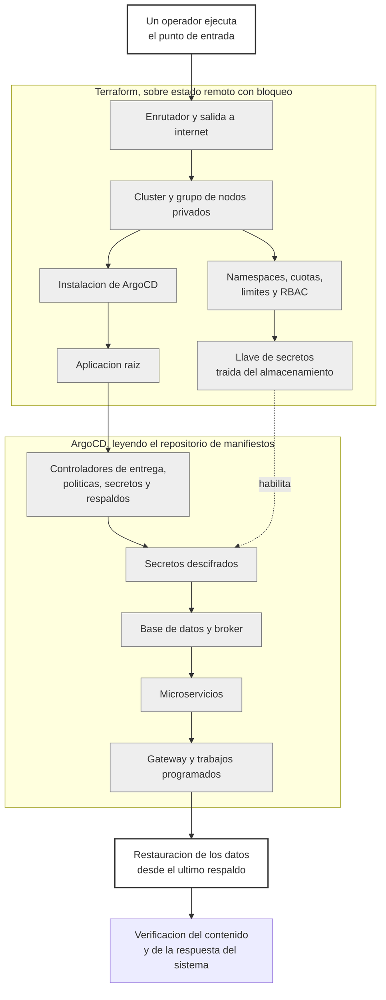

# Practica 9

Continuidad operativa y recuperacion ante desastres.

La plataforma que se entrego en la practica anterior se desplegaba de forma controlada pero nunca habia sido sometida a una perdida real, y al revisarla con criterio de continuidad tenia tres puntos unicos de fallo. Los datos vivian en volumenes que nadie respaldaba, el estado de Terraform vivia en una sola maquina y la llave que descifra los secretos existia unicamente dentro del cluster. Ahora el entorno completo se reconstruye desde un solo comando, los respaldos se programan hacia almacenamiento externo, la llave sobrevive a la destruccion del cluster y todo ello se demostro destruyendo el entorno y levantandolo de nuevo con el cronometro corriendo.

## Tabla de enlaces

| Item | Enlace o dato |
| --- | --- |
| Repositorio GitOps | <https://github.com/jaguzaro/Practicas-SA-B-202201395-gitops> |
| Aplicacion raiz en ArgoCD | plataforma, en el namespace argocd |
| Punto de entrada del bootstrap | P9/bootstrap.sh |
| Backend remoto de Terraform | Cloud Storage de Google, bucket softwareavanz-terraform-estado con prefijo practica9, versionado y con bloqueo nativo |
| Schedule de Velero | velero-diario y velero-cadaseishoras, con destino gs://softwareavanz-respaldos bajo el prefijo velero |
| Reconstruccion cronometrada | P9/evidencias/reconstruccion.txt |
| Restauracion de datos | P9/evidencias/restauracion-de-datos.txt |
| Prueba de perdida de nodo | P9/evidencias/perdida-de-nodo.txt |
| RTO y RPO declarados | Declarados 45 minutos de RTO y 6 horas de RPO en evidencias/objetivos-declarados.txt, medidos 1 hora 42 minutos y 5 minutos de escrituras perdidas en evidencias/desastre-total.txt |
| Video demostrativo | <https://drive.google.com/drive/folders/1Hjqo2IHasX-f175W1FRpp_1Syr6e57XX?usp=sharing> |

## Diagrama del bootstrap

Lo unico que hace una persona es ejecutar el punto de entrada y, cuando la plataforma ya esta en linea, pedir la restauracion de los datos eligiendo desde que respaldo. Todo lo demas ocurre solo. El orden no es decorativo sino una cadena de dependencias reales, porque los nodos privados no pueden descargar imagenes sin la salida a internet, ArgoCD no puede crear la aplicacion raiz antes de que exista su propio tipo de recurso, los secretos no se descifran sin la llave restaurada y los microservicios no arrancan sin la base de datos.

## Bootstrap de dia cero

El punto de entrada es bootstrap.sh y no requiere ningun paso intermedio. Comprueba que existan las herramientas y las credenciales, crea el cluster con Terraform, obtiene acceso a el, aplica el resto de la infraestructura y espera a que ArgoCD termine de levantar la plataforma, escribiendo marcas de tiempo en la bitacora de evidencias.

Terraform se detiene deliberadamente en cuatro cosas, el cluster con su salida a internet, los namespaces con sus cuotas y su RBAC, la llave de los secretos y ArgoCD con su aplicacion raiz. A partir de ahi el patron de aplicacion de aplicaciones toma el control y levanta veintidos aplicaciones, entre ellas los propios controladores de entrega progresiva, politicas de admision, secretos sellados y respaldos, que en la entrega anterior instalaba Terraform. Ese traslado es lo que convierte el arranque en algo reproducible, porque agregar un componente nuevo ya no significa tocar la infraestructura sino agregar un archivo al repositorio de manifiestos.

La creacion del cluster se hace en dos aplicaciones de Terraform en lugar de una porque los proveedores de Kubernetes y de Helm necesitan la direccion y el certificado del cluster, y esos valores no existen hasta que el cluster esta creado. El guion resuelve esa dependencia sin que el operador tenga que saberla.

## Estado remoto con bloqueo

El estado vive en un bucket de Cloud Storage con versionado activado, de modo que cada aplicacion conserva la version anterior y una corrupcion se revierte. El bloqueo lo provee el propio almacenamiento mediante una escritura condicional del archivo de bloqueo, que solo tiene exito si el archivo no existe, por lo que una segunda ejecucion simultanea falla al intentar tomarlo e informa quien lo tiene, desde cuando y que operacion esta ejecutando. No hace falta una base de datos aparte como ocurre con otros proveedores.

En el repositorio no hay ningun archivo de estado ni credenciales. Lo unico que se versiona es el archivo de bloqueo de versiones de los proveedores, que garantiza que cualquiera obtenga exactamente las mismas versiones. La prueba del bloqueo, con dos ejecuciones compitiendo por el estado, esta en evidencias/terraform-bloqueo-estado.txt.

## Respaldos

Velero escribe a un bucket de Cloud Storage externo al cluster que respalda, bajo su propio prefijo. Hay dos calendarios. Uno diario a las seis de la manana cubre produccion, desarrollo y el namespace de los secretos, con retencion de siete dias. Otro cada seis horas cubre solo produccion, con retencion de tres dias. La retencion no es decorativa, un respaldo disparado desde el calendario nace con vencimiento a tres dias mientras que uno manual conserva el mes por defecto.

Los volumenes se respaldan por sistema de archivos y no mediante instantaneas de disco. Una instantanea es mas rapida pero queda atada a la infraestructura de discos de la nube, mientras que el respaldo por sistema de archivos deja el contenido como objetos en el bucket y se puede restaurar sobre un cluster distinto, con otra clase de almacenamiento o incluso en otra region. Para una practica cuyo objetivo es sobrevivir a la destruccion del entorno, esa portabilidad importa mas que la velocidad.

La autenticacion no usa ninguna llave descargada. El pod de Velero suplanta una cuenta de Google mediante federacion de identidades, y esa cuenta es la unica con permiso de escritura sobre el bucket. Ademas de ser mas seguro, es el unico camino posible porque la organizacion prohibe crear llaves de cuenta de servicio. La configuracion completa, con los calendarios, la retencion aplicada y los volumenes incluidos, esta en evidencias/respaldos.txt.

## Continuidad de los secretos

El repositorio de manifiestos es publico y contiene catorce secretos cifrados. La llave que los descifra la genera el controlador dentro del cluster, de modo que perder el cluster convertiria ese repositorio en contenido ilegible para siempre. Por eso la llave se exporto y vive en el bucket de respaldos, fuera del cluster.

Durante el arranque, Terraform lee esa llave del almacenamiento y la crea como Secret con la etiqueta que el controlador busca, antes de que el controlador exista. Cuando ArgoCD lo instala, este encuentra una llave activa y la adopta en lugar de generar una nueva. La prueba de que funciona es doble, en el namespace hay una sola llave y es la restaurada, y el certificado que contiene coincide byte a byte con el que se publico en el repositorio de manifiestos para cifrar los secretos. Sobre esa base, los catorce secretos se descifraron en un cluster que nunca vio la llave original. La comprobacion esta en evidencias/continuidad-de-secretos.txt.

## Resiliencia ante perdida de nodo

Cada microservicio corre con al menos dos replicas, un presupuesto de interrupcion que exige mantener una disponible y una regla de anti afinidad que prefiere colocar las replicas en nodos distintos. La regla es preferida y no obligatoria de forma deliberada, porque con tres nodos y anti afinidad obligatoria el pod adicional que crea la entrega progresiva durante una promocion no tendria donde ir y el flujo de la entrega anterior dejaria de funcionar.

La prueba consistio en drenar un nodo mientras el gateway recibia una peticion por segundo, y se ejecuto tres veces porque las dos primeras revelaron algo que no se esperaba. Con dos replicas de gateway y trafico repartido entre todos los nodos, nueve de doscientas quince peticiones fallaron. Al subir a tres replicas, una por nodo, y cambiar la politica para que el balanceador envie solo a nodos con pod propio, el resultado empeoro a quince fallos de ciento ochenta y una, porque esa politica hace que el balanceador siga enviando al nodo drenado hasta acumular suficientes comprobaciones fallidas, y mientras tanto el trafico cae en un nodo que ya no tiene a quien entregarselo. Las tres mediciones estan en evidencias/perdida-de-nodo.txt.

Lo que corrigio el problema no fue una configuracion sino un procedimiento. Retirando primero el gateway del nodo, esperando setenta y cinco segundos a que el balanceador lo note y drenando despues, los fallos bajaron a cinco de doscientas setenta y cinco, concentrados en una ventana de veintisiete segundos durante la expulsion de los pods. Ese orden quedo documentado en el runbook, porque es conocimiento que no sirve de nada si vive solo en la cabeza de quien hizo la prueba.

## Restauracion de datos verificada

Los datos verificables son los que escribe un trabajo programado cada dos minutos, una fila con el carne del estudiante y la marca de tiempo de la ejecucion. Sirven a la vez para comprobar que la restauracion trajo contenido real y para medir exactamente cuanto se perdio, contando filas y comparando marcas.

La prueba elimino el StatefulSet de la base y su volumen, de modo que no quedo un solo byte, y despues pidio la restauracion desde el respaldo. Velero volvio a crear el volumen, lo lleno desde el almacenamiento de objetos y recreo la base. Se recuperaron treinta y cinco filas de las treinta y ocho que existian antes del incidente, todas con el carne correcto y con marcas de tiempo coherentes, y la otra tabla del mismo volumen, la de eventos de auditoria, tambien volvio con su contenido. Las tres filas faltantes son las escritas despues del respaldo, que es precisamente lo que el objetivo de punto de recuperacion admite perder. La recuperacion del dato tardo sesenta y cuatro segundos.

Un detalle del procedimiento merece mencion. Hubo que retirarle temporalmente la sincronizacion automatica a ArgoCD, porque de lo contrario habria recreado la base vacia compitiendo con la restauracion. Esa es la contrapartida de tener un sistema que se autorrepara, y esta anotada en el runbook.

## Prueba de recuperacion cronometrada

El entorno completo se destruyo con Terraform y se reconstruyo desde el punto de entrada unico, con el cronometro corriendo. A las 20:34 no quedaba plano de control, nodos, volumenes ni balanceador, y a las 22:11 el gateway respondia una peticion de negocio con los datos restaurados desde el respaldo. Una hora y 42 minutos frente a los 45 minutos comprometidos.

La brecha tiene una causa concreta y util. A los treinta minutos de la reconstruccion el controlador de ArgoCD empezo a morir por agotamiento de memoria, porque su limite estaba dimensionado para un sistema con menos aplicaciones y en un arranque en frio las veintidos reconcilian a la vez contra un cluster vacio. Mientras se reiniciaba en bucle ninguna sincronizacion progresaba, y el sintoma visible era enganoso, los Rollout se quejaban de que faltaba su plantilla de analisis cuando lo que faltaba era quien terminara de aplicarla. Es un defecto que solo se manifiesta en una reconstruccion total y que, de no haberse hecho esta prueba, habria aparecido durante un desastre real. El limite ya esta corregido en el codigo.

De la perdida de datos, el respaldo tenia 88 filas y antes del desastre habia 91, de modo que se perdieron las tres escritas en los cinco minutos intermedios, muy por debajo de las seis horas admitidas. El contenido recuperado se verifico fila por fila con el carne del estudiante y sus marcas de tiempo. El analisis completo, con los seis campos que pide la plantilla, esta en informe-dr.md.

## Documentacion

El procedimiento completo esta en runbook.md, escrito para que lo ejecute alguien que no conoce el sistema, con los comandos concretos, el orden de dependencias, que verificar en cada paso y que hacer cuando algo no levanta. El analisis del ejercicio de recuperacion esta en informe-dr.md. Los objetivos comprometidos y su justificacion se escribieron antes de medir, en evidencias/objetivos-declarados.txt.

## Video

PENDIENTE_VIDEO

## Preguntas teoricas

### Que distingue a un sistema respaldado de uno recuperable

Un sistema respaldado tiene copias, un sistema recuperable ha demostrado que puede volver a funcionar a partir de ellas en un tiempo conocido. La diferencia aparece en todo lo que un respaldo no cubre, el orden en que hay que levantar las piezas, las credenciales que hacen falta para empezar, quien sabe ejecutar el procedimiento y cuanto tarda de verdad. Antes de esta practica los datos de la plataforma podian haberse respaldado y aun asi el sistema no habria sido recuperable, porque la llave de los secretos vivia dentro del cluster y el estado de la infraestructura vivia en una sola maquina. Un respaldo que nunca se ha restaurado es una suposicion, no una garantia.

### Por que el estado de Terraform es un punto unico de fallo y que cambia al moverlo

El estado es el registro de que recursos existen y con que identidad. Sin el, Terraform no sabe que el cluster que ve en la nube es suyo, de modo que un plan propondria crear todo de nuevo y un intento de aplicar chocaria contra recursos ya existentes. Mientras vivia en una sola maquina, esa maquina era la unica capaz de operar la infraestructura y su perdida obligaba a reconstruir el estado a mano importando recurso por recurso. Al moverlo a un almacenamiento remoto con versionado, cualquiera con permiso puede operar desde cualquier equipo, una aplicacion corrupta se revierte a la version anterior y el bloqueo impide que dos personas se pisen. Lo que cambia no es la capacidad tecnica sino quien y desde donde puede recuperar el sistema.

### Que perderia este sistema si el cluster desapareciera ahora mismo

Las escrituras ocurridas desde el ultimo respaldo, y nada mas. El codigo de infraestructura y los charts estan en el repositorio de codigo, los manifiestos y los secretos cifrados en el de manifiestos, el estado en su bucket con versionado, la llave de descifrado en el bucket de respaldos y el contenido de los volumenes en el mismo bucket como objetos. Tambien se perderian la direccion publica del gateway, que cambia en cada reconstruccion y por eso no se referencia en ningun sitio, y los mensajes que estuvieran en la cola del broker sin consumir, que no se respaldan porque son transitorios por naturaleza. Lo importante es que la lista es corta y conocida, que es justamente lo que distingue a un sistema preparado de uno que no lo esta.

### Por que respaldar por sistema de archivos y no por instantaneas de disco

Una instantanea de disco es mas rapida de tomar y de restaurar, pero produce un objeto atado a la infraestructura de discos de esa nube, esa region y esa clase de almacenamiento. Si el desastre consiste precisamente en perder el entorno, restaurar a partir de una instantanea obliga a reconstruirlo con la misma forma. El respaldo por sistema de archivos copia el contenido como objetos en un bucket, de modo que puede restaurarse sobre un cluster distinto, con otra clase de almacenamiento e incluso en otra region. El precio es tiempo, porque hay que leer y escribir archivo por archivo, y en esta plataforma ese precio fue de poco mas de un minuto para ochenta megabytes, muy por debajo del objetivo comprometido.

### Que revelo la prueba de perdida de nodo que no se sabia antes

Que la resiliencia no estaba donde se suponia. Las replicas, el presupuesto de interrupcion y la anti afinidad funcionaron como debian, ningun servicio se quedo sin pods disponibles en ningun momento, y aun asi el sistema perdio peticiones. El eslabon debil era el balanceador externo, que necesita varios ciclos de comprobacion para dejar de enviar trafico a un nodo que ya no tiene a quien entregarselo. La leccion es que la resiliencia de la capa de aplicacion no se propaga sola a la capa que esta delante, y que el remedio puede no ser una configuracion sino un orden de operaciones. La segunda leccion es incomoda y por eso vale mas, un cambio de configuracion aparentemente correcto empeoro el resultado, y solo se supo porque se volvio a medir.

### Cual es el limite de este diseno y que haria falta para superarlo

El limite es el objetivo de punto de recuperacion. Con respaldos cada seis horas, el sistema admite perder hasta seis horas de escrituras, y eso es aceptable para una plataforma que registra ejecuciones programadas y eventos de auditoria pero seria inadmisible para una que mueve dinero. Bajarlo a minutos exige un mecanismo distinto, no respaldos mas frecuentes sino replicacion continua de la base hacia otra zona con envio de registros de transaccion, de modo que la copia este siempre a segundos del original. El costo se multiplica, porque implica una segunda base encendida permanentemente, y por eso la decision no es tecnica sino de negocio. El segundo limite es que la recuperacion depende de Google Cloud, y un desastre que afecte al proyecto entero o a la cuenta dejaria fuera de alcance el estado, la llave y los respaldos a la vez, de modo que una version mas seria de este diseno guardaria al menos la llave y una copia de los respaldos en un proveedor distinto.
